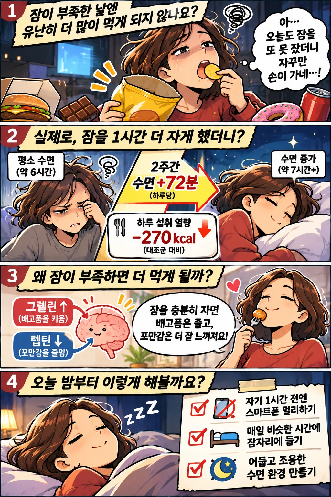

## 잠이 부족한 날, 유난히 배고프지 않나요?

늦게까지 휴대전화를 보다가 겨우 잠들고, 다음 날 아침에는 커피부터 찾은 적 있나요? 점심을 먹고도 달콤한 간식이 당기거나, 저녁에 평소보다 많이 먹게 되는 날도 있죠.

물론 피곤한 날마다 모두 더 많이 먹는 건 아니에요. 하지만 **잠이 부족한 생활이 식사량 관리에도 영향을 줄 수 있다**는 흥미로운 연구가 있어요.

다이어트를 위해 먹는 양을 더 줄이기 전에, 평소 잠을 충분히 자고 있는지도 한번 살펴볼까요?

## 잠을 1시간 더 자게 했더니?

2022년 [Tasali 연구진의 실험](https://pubmed.ncbi.nlm.nih.gov/35129580/)에서는 평소 하루 6시간 30분 미만으로 자는 21~40세 성인 80명을 살펴봤어요.

연구진은 참가자들을 두 그룹으로 나눴어요. 한쪽은 평소대로 생활하고, 다른 쪽은 수면 상담을 통해 침대에서 보내는 시간을 늘리도록 했죠. 별도의 다이어트 식단이나 운동 프로그램은 제공하지 않았어요.

2주 뒤 놀라운 차이가 나타났어요.

- **수면 시간:** 상담을 받은 그룹은 대조군보다 하룻밤에 평균 약 **1시간 12분** 더 잤어요.
- **섭취 열량:** 하루 섭취 열량의 변화는 대조군과 비교해 평균 약 **270kcal 적었어요.**

잠을 더 잘 수 있도록 생활을 바꿨더니, 먹는 양에서도 차이가 나타난 거예요. 연구진은 단순한 식사 기록만이 아니라 에너지 소비량과 체내 에너지 저장량 변화를 활용해 섭취 열량을 추정했어요.

다만 이 결과는 **평소 잠이 부족했던 사람들에게서 2주 동안 관찰된 변화**예요. 잠을 한 시간 더 자면 누구나 매일 270kcal를 덜 먹거나, 그만큼 살이 빠진다는 뜻은 아니에요.

## 잠과 식욕은 어떤 관계일까요?

잠이 부족한 날에는 피로 때문에 식사를 준비하기 귀찮아지거나, 늦게까지 깨어 있는 동안 간식을 먹을 기회가 늘어날 수 있어요. 충분한 수면이 식사 습관을 지키는 데 도움이 될 수 있는 이유죠.

다만 앞의 연구만으로 **왜 섭취량이 줄었는지 정확한 원인까지 확인된 것은 아니에요.** 야식이 줄어서인지, 다른 식사 행동이 바뀌어서인지는 구분해서 생각해야 해요.

중요한 건 잠이 식단과 무관한 문제가 아니라는 점이에요. 체중 관리를 하고 있다면 운동과 식사뿐 아니라 **수면 시간도 생활 습관의 한 부분**으로 챙겨볼 만해요.

## 오늘 밤부터 바꿔볼 수 있는 습관

잠이 부족하다면 거창한 계획보다 작은 변화부터 시작해 보세요.

- **휴대전화는 조금 일찍 내려놓기.** 잠자리에 누워 영상을 보다 취침 시간이 밀린다면, 침대 밖에 휴대전화를 두는 것부터 시도해 보세요.
- **취침 준비를 앞당기기.** 아침에 일어나야 하는 시간이 정해져 있다면, 밤에 씻고 정리하는 시간을 조금 앞당겨 잠잘 여유를 만들어 보세요.
- **잠들기 편한 환경 만들기.** 침실의 빛과 소음을 줄이고 편안한 온도를 유지해 보세요.
- **무리한 식단 제한부터 늘리지 않기.** 피곤해서 식사 조절이 힘들다면 먼저 수면 부족을 개선할 수 있는지 살펴보세요.

여기서 구분할 점이 있어요. **잠잘 시간이 부족한 것과, 시간을 충분히 확보해도 잠들거나 잠을 유지하기 어려운 것은 달라요.** 후자의 문제가 계속된다면 단순히 침대에 오래 누워 있기보다 의료진과 상담하는 게 좋아요.

## 다이어트할 때 잠도 함께 챙겨보세요

다이어트를 시작하면 보통 식사량과 운동부터 신경 쓰게 돼요. 하지만 매일 잠이 부족하다면 수면을 조금 더 확보하는 것 역시 도움이 될 수 있어요.

**식단을 더 엄격하게 만들기 전에, 오늘 밤은 조금 일찍 잠자리에 들어보는 건 어떨까요?**

충분히 자는 습관은 체중 관리뿐 아니라 활기찬 하루를 보내는 데도 중요한 출발점이에요.

## 참고 자료

- [Tasali 외, 수면 연장과 에너지 섭취량에 관한 무작위시험, JAMA Internal Medicine, 2022](https://pubmed.ncbi.nlm.nih.gov/35129580/)
