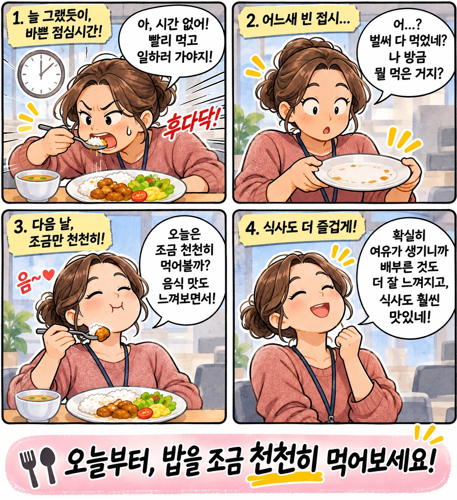

## 오늘 점심, 몇 분 만에 드셨나요?

점심시간이 되자마자 식당으로 달려가고, 휴대전화로 메시지를 확인하며 밥을 먹고, 정신을 차려 보면 어느새 빈 접시만 남아 있죠. 바쁜 날에는 뭘 먹었는지 제대로 기억나지 않을 때도 있어요.

그런데 오늘은 조금 다르게 먹어보면 어떨까요? 거창한 식단을 새로 짜는 대신 **평소보다 한 입만 더 여유롭게 먹는 것**부터 시작하는 거예요.

천천히 먹는 습관의 장점은 단순히 식사 시간을 늘리는 데 있지 않아요. 음식의 맛을 느끼고, 지금 얼마나 배가 부른지 알아차릴 틈을 만들 수 있다는 거죠.

## 천천히 먹으면 식사량에도 변화가 생길까요?

실제로 식사 속도를 바꿔 본 연구도 있어요. 2014년 [Shah 연구진의 실험](https://pubmed.ncbi.nlm.nih.gov/24388483/)에서는 성인 70명이 이틀에 걸쳐 같은 점심 메뉴를 원하는 만큼 먹었어요. 한 번은 빠르게, 다른 한 번은 천천히 먹는 방식이었죠.

정상체중 참가자들은 천천히 먹었을 때 한 끼 섭취 열량이 유의하게 줄었어요. 과체중·비만 참가자들에게서는 섭취 열량의 차이가 뚜렷하지 않았지만, 두 집단 모두 식사 시작 60분 뒤에는 천천히 먹은 날 배고픔을 덜 느꼈다고 답했어요.

흥미로운 결과죠? 다만 이 실험은 두 번의 점심을 비교한 연구예요. **천천히 먹는다고 누구나 살이 빠진다는 뜻은 아니에요.** 연구에서도 체중 집단에 따라 식사 속도의 효과가 다르다는 통계적 근거는 확인되지 않았어요.

그래도 일상에서 시도해 볼 이유는 충분해요. 무작정 빨리 먹기보다, 식사 중간에 내 배부름을 살필 기회를 만들어 주니까요.

## 천천히 먹는 습관, 어렵지 않아요

‘한 입에 30번 씹기’나 ‘반드시 20분 이상 먹기’처럼 숫자부터 정할 필요는 없어요. 오늘 먹는 한 끼에서 아래 세 가지만 가볍게 떠올려 보세요.

- **한 입을 먹었다면 천천히 씹고 삼키기.** 다음 음식을 서둘러 입에 넣지 않고, 지금 먹는 음식의 맛과 식감을 느껴보세요.
- **식사 중간에 수저를 잠깐 내려놓기.** ‘아직 배가 고픈가? 어느 정도 배가 찼지?’ 하고 스스로에게 물어보세요.
- **가능하면 먹는 시간에는 먹는 데 집중하기.** 화면을 보거나 일을 하면서 먹었다면, 잠시만이라도 음식에 눈을 돌려보세요.

처음부터 모든 끼니를 바꿀 필요는 없어요. 오늘 점심 한 번, 내일 저녁 한 번. 이렇게 편한 순간부터 시작하면 돼요.

## 목표는 덜 먹기가 아니라, 여유 있게 먹기

천천히 먹다 보면 평소보다 일찍 배부름을 느낄 수도 있고, 먹는 양에는 별 차이가 없을 수도 있어요. 어느 쪽이든 괜찮아요. 배가 고프다면 더 먹으면 되고요.

중요한 건 억지로 식사량을 줄이는 게 아니에요. **서두르느라 놓쳤던 맛과 배부름을 느껴보는 것**, 그게 이번 습관의 출발점이에요.

오늘 한 끼만이라도 수저를 잠깐 내려놓고, 음식의 맛을 느끼며 먹어보세요. 작은 여유가 내 식사 습관을 바꾸는 첫걸음이 될 수 있어요.

## 참고 자료

- [Shah 등, 2014: 식사 속도와 한 끼 섭취량을 비교한 무작위 교차시험](https://pubmed.ncbi.nlm.nih.gov/24388483/) — 성인 70명의 점심 실험이며 장기 체중 감량 시험은 아닙니다.
