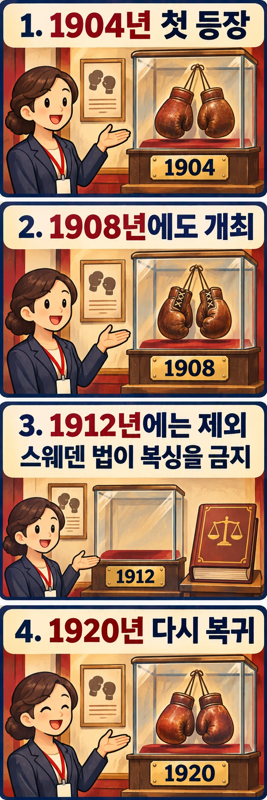

## 올림픽에 등장한 복싱이 왜 사라졌을까요?

올림픽 복싱의 옛 기록을 보다가 1912년에 이르면 뜻밖의 빈칸을 만나게 됩니다. 우승자의 이름을 찾기 어려운 것이 아니라, 스톡홀름 대회에서는 복싱 경기가 열리지 않았기 때문입니다. 이미 올림픽에 들어온 종목인데도 왜 출전 무대가 사라졌을까요?

핵심은 당시 개최국의 법에 있습니다. 복싱의 이력만 따라가면 놓치기 쉬운, 경기 바깥의 이야기입니다.

## 1904년의 등장이 영구적인 자리를 뜻하지는 않았습니다

[캐나다 올림픽위원회의 복싱 역사](https://olympic.ca/sports/boxing/)에 따르면 복싱은 1904년 세인트루이스 올림픽 프로그램에 처음 포함됐고, 1908년 런던 대회에서도 열렸습니다. 따라서 스톡홀름의 공백은 복싱이 아직 올림픽에 소개되지 않았기 때문에 생긴 일이 아닙니다.

이 순서를 기억하면 질문이 선명해집니다. ‘복싱은 언제 올림픽 종목이 됐을까요?’에서 한 걸음 더 나아가, ‘이미 개최된 종목도 다음 대회에서 빠질 수 있었을까요?’라고 물을 수 있습니다. 스톡홀름은 바로 그 사례입니다.

## 개최국의 법이 링을 열지 못하게 했습니다

[스웨덴 올림픽위원회의 역사 설명](https://sok.se/arkiv-for-artiklar/2015-01-01-boxningens-olympiska-historia.html)은 스웨덴 법이 복싱을 금지했기 때문에 1912년 대회에 포함되지 않았다고 설명합니다. 캐나다 올림픽위원회 역시 같은 이유를 기록하고 있습니다.

이를 선수의 기량이나 특정 경기의 승패 문제로 이해하면 핵심을 놓치게 됩니다. 경기가 시작되기 전에, 개최지에서 그 종목을 열 수 있는지가 문제가 됐던 것입니다. 올림픽이라는 국제 무대에도 개최국의 법이라는 조건이 작용했다는 점이 이 사건의 중요한 맥락입니다.

다만 이 기록만으로 당시 모든 스웨덴인의 생각이 같았다거나, 어떤 한 인물이 제외를 주도했다고 단정할 수는 없습니다. 법 조항의 구체적인 적용 범위나 결정 과정까지 확대하기보다, 복싱의 대회 제외 사유로 공식 역사 자료가 무엇을 제시하는지에 초점을 맞추는 편이 정확합니다.

## 1920년 복귀는 무엇을 보여 줄까요?

복싱은 1920년 안트베르펜 올림픽에서 프로그램에 돌아왔습니다. 앞서 소개한 두 올림픽위원회 자료가 모두 이 복귀를 기록합니다. 스톡홀름에서 열리지 않았다는 사실을 복싱의 올림픽 역사가 그때 끝났다는 뜻으로 읽어서는 안 되는 이유입니다.

이 전후 관계에서 읽을 수 있는 의미는 분명합니다. 한 대회의 개최 여부와 종목의 장기적인 역사는 구분해서 살펴봐야 합니다. 다만 1920년 복귀 자체가 스웨덴 법의 변경 시점이나 이유를 증명하는 것은 아닙니다. 다른 도시의 대회에서 다시 열렸다는 사실과 스웨덴 국내 제도의 변화는 별개의 질문입니다.

## 경기 결과가 없는 해도 역사입니다

스톡홀름의 빈칸을 통해 복싱사를 읽는 시야를 넓힐 수 있습니다. 누가 강했는지, 어떤 펀치로 이겼는지만이 아니라 누가 어떤 조건에서 링에 오를 수 있었는지도 역사에 포함됩니다. 이는 이 사건에서 생각해 볼 수 있는 제도적 의미입니다.

1912년 올림픽에 복싱이 없었던 이유에 대한 답은 당시 스웨덴 법에 있습니다. 그리고 1920년의 복귀까지 함께 보면, 그 빈자리는 종목의 소멸보다 개최 환경과 출전 무대의 관계를 보여 줍니다. 경기 기록에서 빠진 한 해가 오히려 링을 가능하게 하는 조건을 묻게 합니다.

## 참고 자료

- [스웨덴 올림픽위원회: 복싱의 올림픽 역사](https://sok.se/arkiv-for-artiklar/2015-01-01-boxningens-olympiska-historia.html) — 1912년 제외 사유와 1920년 이후 복귀에 관한 설명입니다.
- [캐나다 올림픽위원회: 복싱](https://olympic.ca/sports/boxing/) — ‘Olympic Boxing History’의 1904·1908·1912·1920년 기록을 참고했습니다.
