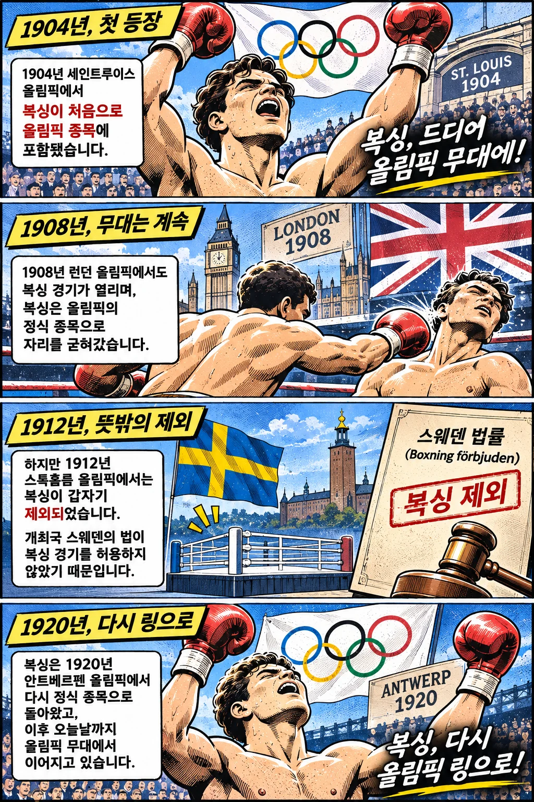

1904년 세인트루이스 올림픽에서 복싱 경기가 처음 열렸습니다. 1908년 런던 올림픽에서도 복싱 선수들은 링에 올랐습니다. 그런데 불과 4년 뒤, 1912년 스톡홀름 올림픽에서는 복싱 경기가 아예 열리지 않았습니다.

우승자가 없었던 정도가 아닙니다. **선수들이 겨룰 링 자체가 마련되지 않았습니다.**

세계 각국의 선수가 모이는 올림픽에서 이미 치러지던 종목이 왜 빠졌을까요? 답은 의외로 선수나 경기장 바깥, **개최국 스웨덴의 법**에 있었습니다.

## 올림픽에 들어왔다고 언제나 열리는 것은 아니었습니다

복싱은 1904년 세인트루이스 올림픽에 처음 등장했고, 1908년 런던 대회에서도 정식으로 경기가 열렸습니다. [캐나다 올림픽위원회의 복싱 역사](https://olympic.ca/sports/boxing/)에서도 확인할 수 있는 기록입니다.

그래서 1912년의 공백은 더욱 뜻밖입니다. 복싱이 아직 올림픽에 소개되지 않았던 것도, 앞선 대회에서 경기를 치르지 못했던 것도 아니기 때문입니다.

우리는 올림픽 종목이 한 번 자리 잡으면 다음 대회에도 자연스럽게 이어진다고 생각하기 쉽습니다. 하지만 초기 올림픽의 종목 구성은 오늘날처럼 당연한 것이 아니었습니다. 스톡홀름의 사례는 **국제 대회의 프로그램도 개최지의 제도적 조건에 영향을 받을 수 있다**는 사실을 보여 줍니다.

## 스톡홀름의 링을 가로막은 것은 상대 선수가 아니었습니다

1912년 대회를 개최한 나라는 스웨덴이었습니다. 그런데 당시 스웨덴에서는 복싱이 법으로 금지돼 있었습니다. [스웨덴 올림픽위원회의 복싱 역사](https://sok.se/arkiv-for-artiklar/2015-01-01-boxningens-olympiska-historia.html)와 [캐나다 올림픽위원회의 설명](https://olympic.ca/sports/boxing/)은 이 때문에 스톡홀름 올림픽에서 복싱이 제외됐다고 기록합니다.

복싱 선수들이 링 위에서 패배한 것이 아니었습니다. 경기의 승패를 가리기 전에 **그 장소에서 복싱 경기를 열 수 있는가**라는 문제가 먼저 놓여 있었습니다.

올림픽은 여러 나라의 선수가 참가하는 국제 스포츠 행사입니다. 그러나 실제 대회는 어느 한 나라의 도시에서 개최됩니다. 스톡홀름에서는 그 개최국의 법적 환경이 복싱 종목의 개최를 가로막았습니다.

그렇다면 스웨덴은 왜 복싱을 금지했을까요? 이 질문도 흥미롭지만, 현재 참고한 두 올림픽위원회 자료만으로는 구체적인 입법 동기나 결정 과정까지 확인하기 어렵습니다. 특정 인물이나 집단이 어떤 이유로 복싱을 배제했다고 추측하기보다, **당시 법적 금지가 1912년 종목 제외의 이유였다는 확인 가능한 사실**에서 출발해야 합니다.

## 스포츠와 법이 충돌하면 누가 링에 오를 수 있을까요?

복싱의 역사는 흔히 위대한 선수, 극적인 KO, 챔피언의 탄생으로 기억됩니다. 하지만 1912년의 스톡홀름에서는 그런 이야기가 시작될 기회조차 없었습니다.

여기서 눈여겨볼 것은 국제적인 스포츠의 규칙과 개최국의 법이 서로 다른 층위에서 작용한다는 점입니다. 선수들이 복싱을 할 준비가 되어 있더라도, 개최 환경이 허용하지 않으면 대회 프로그램에 종목이 들어가지 못할 수 있습니다.

이 사건을 오늘날 모든 국제대회에 그대로 적용할 수는 없습니다. 시대에 따라 올림픽 운영 방식과 종목 선정 절차도 달라졌기 때문입니다. 다만 1912년의 사례는 **스포츠의 무대가 선수의 실력만으로 만들어지는 것은 아니다**라는 사실을 생각하게 합니다.

그해 올림픽 복싱의 역사에 남은 것은 승자의 이름이 아니라, **열리지 못한 경기의 빈자리**였습니다.

## 1920년, 다시 열린 링

복싱은 1920년 안트베르펜 올림픽에서 다시 열렸습니다. [스웨덴 올림픽위원회](https://sok.se/arkiv-for-artiklar/2015-01-01-boxningens-olympiska-historia.html)와 [캐나다 올림픽위원회](https://olympic.ca/sports/boxing/) 모두 이 복귀를 기록합니다.

1912년의 제외가 복싱의 올림픽 역사 전체를 끝낸 것은 아니었던 셈입니다. 개최지가 바뀐 뒤 복싱은 다시 올림픽 프로그램에 등장했습니다.

여기서 한 가지는 구분해야 합니다. 1920년에 복싱이 복귀했다는 사실만으로 스웨덴의 법이 그때 개정됐다고 말할 수는 없습니다. 안트베르펜에서 경기가 다시 열렸다는 기록과 스웨덴 국내법의 변화는 별도로 확인해야 할 문제입니다.

중요한 것은 1904년의 첫 등장, 1908년의 개최, 1912년의 제외, 1920년의 복귀가 이어지면서 **올림픽 복싱의 역사가 단순히 끊김 없는 승부의 기록은 아니라는 점**을 드러낸다는 사실입니다.

## 경기 결과가 없는 해도 복싱의 역사입니다

1912년 스톡홀름 올림픽에서 복싱 선수들은 패배하지 않았습니다. **그들에게는 싸울 링조차 주어지지 않았습니다.**

복싱은 1920년 다시 올림픽 무대로 돌아왔습니다. 하지만 스톡홀름의 빈자리는 지금도 특별한 질문을 남깁니다. 스포츠가 국제적인 무대에 올랐다는 사실만으로, 언제 어디서나 그 경기가 열릴 수 있는 것은 아니라는 질문입니다.

**스포츠의 역사는 링 위에서 승리한 선수들만의 이야기가 아닙니다. 누가, 언제, 어떤 조건에서 그 링에 오를 수 있었는가에 관한 역사이기도 합니다.**

## 참고 자료

- [스웨덴 올림픽위원회 — 복싱의 올림픽 역사](https://sok.se/arkiv-for-artiklar/2015-01-01-boxningens-olympiska-historia.html): 스웨덴 법에 따른 1912년 제외와 1920년 복귀를 설명합니다.
- [캐나다 올림픽위원회 — 복싱](https://olympic.ca/sports/boxing/): 1904년 첫 등장, 1908년 개최, 1912년 제외 및 1920년 복귀를 기록합니다.
