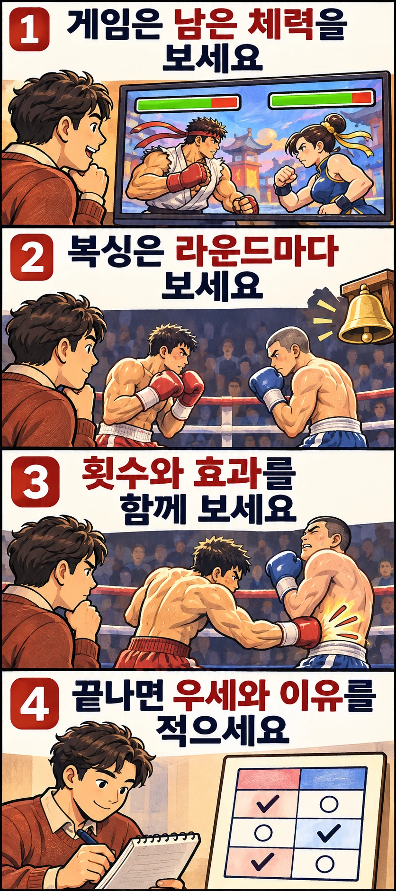

스트리트 파이터 6를 볼 때는 화면 위 체력 막대에 눈이 갑니다. 공격이 이어진 뒤 남은 체력을 보면 누가 유리한지 빠르게 짐작할 수 있습니다. 그렇다면 복싱도 머릿속으로 상대의 체력을 깎아 가며 보면 될까요?

판정까지 가는 복싱에서는 **누가 더 지쳐 보이는지보다 각 라운드를 어떻게 치렀는지**를 구분하는 편이 도움이 됩니다. 게임과 실제 경기가 승부를 숫자로 정리하는 방식부터 살펴보겠습니다.

## 체력 막대는 승리 조건을 보여 줍니다

스트리트 파이터 6의 공식 매뉴얼은 체력 게이지를 캐릭터의 남은 체력을 보여 주는 표시로 설명합니다. 그 아래의 드라이브 게이지는 별도의 기술 사용을 관리하는 표시입니다. 둘을 같은 막대로 읽으면 안 됩니다. [캡콤 공식 화면 안내](https://game.capcom.com/manual/SF6/en/ps4/page/3/2)

PlayVS의 스트리트 파이터 6 대회 규정은 KO가 나오기 전에 라운드 시간이 끝나면 남은 체력이 더 많은 쪽이 해당 라운드를 이긴다고 안내합니다. 여기서 체력 막대는 단순한 분위기 연출을 넘어 승리 조건에 연결됩니다. [PlayVS 스트리트 파이터 6 경기 규정](https://help.playvs.com/en/articles/9689384-playvs-scholastic-street-fighter-6-rulebook)

이런 화면에 익숙하면 실제 복싱에서도 ‘강한 공격을 많이 맞은 선수가 최종적으로 지겠지’라고 생각하기 쉽습니다. 하지만 프로복싱의 판정표는 남은 체력의 추정치가 아닙니다.

## 복싱은 라운드마다 따로 점수를 매깁니다

이 글에서는 미국 복싱위원회협회인 ABC의 프로복싱 채점 안내를 기준으로 설명하겠습니다. 아마추어복싱이나 다른 종목에 그대로 적용하는 설명은 아닙니다.

프로복싱에서 사용하는 **10점 우선제**는 보통 라운드의 승자에게 10점, 패자에게 9점 이하를 주는 방식입니다. 일반적인 우세는 10대9로 기록합니다. 다운이나 매우 큰 우세가 있으면 10대8 등이 나올 수 있으며, 반칙 감점도 점수에 영향을 줍니다. [ABC 채점 지침](https://www.abcboxing.com/abc-regulatory-guidelines/)

따라서 10대9는 펀치를 열 번과 아홉 번 맞혔다는 뜻이 아닙니다. 10점을 받은 선수의 체력이 가득 남았다는 뜻도 아닙니다. **그 라운드의 우열을 점수로 표현한 것**입니다.

계산만 보기 위한 가상의 4라운드 예를 들어 보겠습니다. 한 채점자가 빨간 코너 선수에게 세 라운드를 각각 10대9로 주고, 나머지 한 라운드는 파란 코너에게 10대8로 줬다고 가정합니다. 별도 감점이 없다면 합계는 빨간 코너 38점, 파란 코너 37점입니다.

이 경우 가장 크게 밀린 한 라운드가 있어도 빨간 코너가 그 채점자의 점수표에서는 앞섭니다. 경기 전체의 강렬한 장면 하나와 라운드 점수의 합계가 서로 다른 인상을 줄 수 있는 이유입니다.

## 펀치마다 고정된 피해 점수가 있을까요?

실제 복싱에는 ‘잽 한 번은 몇 점, 강한 오른손은 몇 점’이라는 피해량 환산표가 없습니다. ABC 심판 매뉴얼은 깨끗하고 효과적인 타격을 평가하며, 펀치의 수와 효과를 모두 고려하되 강한 타격과 가벼운 타격을 바꾸는 수학 공식은 없다고 설명합니다.

여기서 유효타는 규칙에 맞게 적중한 타격을 뜻합니다. 팔을 휘두른 횟수만 세지 말고, 실제로 어디에 맞았는지와 상대의 방어에 걸렸는지를 함께 보세요. 매뉴얼은 효과적인 공격성, 링 안의 공방을 이끄는 능력, 방어도 평가 요소로 제시합니다. 앞으로 걷는 모습만으로 공격이 효과적이었다고 판단하기는 어렵습니다.

또한 눈에 띄는 상처가 있다고 그 선수가 해당 라운드를 지고 있다고 단정하지 않도록 안내합니다. 화면에 체력 막대가 없는 자리를 얼굴의 인상으로 대신 채우지 않는 것이 좋습니다. [ABC 프로복싱 심판 매뉴얼](https://www.abcboxing.com/wp-content/uploads/2024/09/abc-boxing-judge-manual-2024.pdf)

## 다음 경기는 종료 공이 울릴 때 기록해 보세요

처음부터 복잡한 점수를 모두 맞히려고 애쓰실 필요는 없습니다. 라운드 하나를 온전히 보고, 종료 공이 울리면 어느 선수가 우세했는지와 그 이유를 짧게 적어 보세요. 예를 들어 ‘빨간 코너 우세, 상대의 공격을 막은 뒤 몸통에 정확히 맞혔습니다’처럼 남기면 됩니다.

다음 라운드에는 새 줄을 쓰세요. 앞선 라운드의 좋은 인상 때문에 이후의 접전까지 같은 선수에게 주지 않도록 구분하는 연습입니다. 짧은 하이라이트만으로는 빠진 공방이 있으므로 전체 점수표를 만들기 어렵다는 점도 기억해 주세요.

게임을 다시 보실 때는 체력 막대가 긴장감을 얼마나 빠르게 전달하는지, 복싱을 보실 때는 한 라운드 안에서 우세가 어떻게 만들어지는지 살펴보세요. 같은 격투 장면이라도 **어떤 기준으로 승부를 기록하는지**를 알면 서로 다른 재미가 보입니다.

## 참고 자료

- [캡콤 공식 매뉴얼](https://game.capcom.com/manual/SF6/en/ps4/page/3/2): 체력·드라이브 게이지와 타이머의 역할입니다.
- [PlayVS 스트리트 파이터 6 경기 규정](https://help.playvs.com/en/articles/9689384-playvs-scholastic-street-fighter-6-rulebook): 1.7절의 시간 종료 시 라운드 승리 조건입니다.
- [ABC 채점 지침](https://www.abcboxing.com/abc-regulatory-guidelines/): 10점 우선제와 라운드 점수의 기본 예시입니다.
- [ABC 프로복싱 심판 매뉴얼](https://www.abcboxing.com/wp-content/uploads/2024/09/abc-boxing-judge-manual-2024.pdf): 라운드별 독립 채점과 타격·공방 평가 기준입니다.
