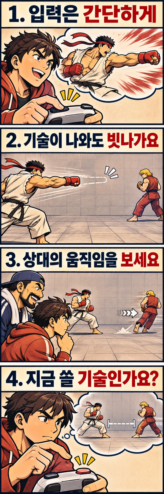

## 기술은 나왔는데, 왜 기회가 되지 않았을까요?

격투게임에서는 원하는 기술이 나오지 않아 아쉬울 때도 있지만, 기술이 정확히 나왔는데 상대가 이미 피한 상황도 생각해 볼 수 있습니다. 두 실패는 고칠 부분이 다릅니다. 앞의 경우에는 입력을, 뒤의 경우에는 그 기술을 선택한 상황을 돌아봐야 합니다.

스트리트 파이터 6의 모던 조작은 이 차이를 살펴보기 좋은 소재입니다. 복잡한 손 조작의 부담을 줄인 뒤에도 플레이어에게 어떤 질문이 남을까요? 핵심은 **‘낼 수 있는 기술’과 ‘지금 쓸 만한 기술’ 사이의 간격**입니다.

## 모던 조작이 간단하게 만드는 것은 무엇인가요?

[캡콤의 공식 소개](https://news.capcomusa.com/2022/06/02/street-fighter-6-redefines-the-genre-in-2023/)는 모던 조작에서 ‘필살기 버튼’과 방향 입력 하나를 조합해 필살기를 사용할 수 있다고 설명합니다. 어시스트 버튼을 누른 채 일부 공격 버튼을 연속해서 눌러 간단한 콤보도 낼 수 있습니다. 콤보는 여러 공격이 이어지는 조합을 뜻합니다.

여기서 간단해지는 것은 **원하는 동작을 명령하는 방식**입니다. 상대가 어디 있는지, 공격을 헛쳤는지, 내가 먼저 움직여도 될지는 별개의 문제입니다. 공식 설명의 간편 입력을 ‘언제나 적절한 공격을 대신 골라 준다’는 뜻으로 받아들이면 두 기능을 혼동하게 됩니다.

개별 캐릭터의 최신 성능이나 조작 방식의 우열보다, 이 설계를 통해 기술 실행과 상황 판단을 나누어 보는 데 초점을 맞춰 보겠습니다.

## 같은 입력 성공도 상황에 따라 의미가 달라집니다

다음은 특정 경기나 영상을 재현한 장면이 아니라, 선택의 차이를 보기 위한 가상 상황입니다. 같은 기술을 정확히 냈다고 가정해 보겠습니다.

상대가 충분히 멀리 있는데 짧은 공격을 냈다면, 입력에는 성공했어도 목표에는 닿지 않을 수 있습니다. 반대로 상대가 공격을 마치고 빈틈을 드러낸 순간이라면, 그 공격이 닿는 거리인지 확인하는 일이 먼저입니다. 두 경우 모두 버튼을 더 정확하게 누르는 것만으로는 문제를 해결하기 어렵습니다.

그래서 게임을 돌아볼 때는 ‘콤보를 끝까지 입력했나요?’와 함께 ‘첫 공격을 시작할 이유가 있었나요?’를 물어볼 수 있습니다. 긴 조합을 외웠다는 사실과 그 조합을 시작할 기회를 잡았다는 사실은 다릅니다. 어시스트로 조합을 내는 방법이 간단해져도, 출발할 상황을 살피는 재미는 남는다고 해석할 수 있습니다.

## 실제 타격에서도 동작 지시와 상황 판단을 나눠 볼 수 있습니다

복싱에서 코치가 정해 준 공격을 미트에 맞추는 상황과, 움직이는 상대를 보고 공격을 고르는 상황을 떠올려 보세요. 미트는 코치가 손에 드는 타격 표적입니다. 정해진 동작을 수행할 수 있어도 상대가 움직이면 그 동작을 시작할 조건을 다시 읽어야 합니다.

예를 들어 ‘상대가 공격했으니 곧바로 반격하겠습니다’라는 선택에는 확인할 것이 빠져 있습니다. 상대가 물러나 이미 멀어졌을 수도 있고, 다른 손의 공격을 이어 갈 수도 있습니다. 반격이라는 이름만으로 기회가 보장되지는 않습니다. 이 예시는 특정 선수의 전술을 설명하는 것이 아니라, 동작의 이름과 사용 조건을 구분하기 위한 기술적 해석입니다.

다만 실제 몸을 게임의 버튼처럼 생각해서는 안 됩니다. 현실의 동작은 자세와 균형, 서로의 움직임에 영향을 받습니다. 게임 속 명령 하나와 실제 펀치 한 번을 같은 난도로 환산할 수도 없습니다. 연결할 만한 지점은 **동작을 실행하는 능력과 사용 조건을 읽는 능력을 따로 살펴볼 수 있다는 점**입니다.

## 다음 플레이에서는 공격을 누르기 직전을 보세요

모던 조작으로 플레이한다면 짧은 공방 하나를 돌아보며 먼저 원하는 기술이 나왔는지 확인해 보세요. 나왔다면 입력 성공 여부에서 한 걸음 더 나아가, 상대의 위치와 움직임이 그 기술을 쓸 이유가 되었는지 살펴보면 좋습니다. 공격을 하지 않고 기다린 선택도 함께 볼 수 있습니다.

조작을 간단하게 만든 설계는 손으로 명령을 내는 데 쓰던 주의를 상대의 행동을 읽는 데 돌려 보는 계기가 될 수 있습니다. 다음에 기술이 빗나갔을 때는 콤보 목록을 다시 펼치기 전에, **그 버튼을 누르기 직전 상대가 무엇을 하고 있었는지**를 한 번 떠올려 보세요.

## 참고 자료

- [캡콤: Street Fighter 6 Redefines the Genre in 2023](https://news.capcomusa.com/2022/06/02/street-fighter-6-redefines-the-genre-in-2023/) — ‘A Modern Control Type for Everyone’의 필살기·어시스트 입력 설명을 참고했습니다.