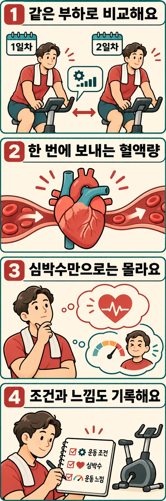

같은 속도로 달리거나 같은 저항으로 자전거를 타는데, 몇 주 전보다 심박수가 낮게 나올 수 있습니다. 운동이 약해진 걸까요? **외부에서 수행한 일이 같다면, 더 적은 심장 박동으로 그 일을 감당하게 된 변화일 수 있습니다.** 다만 숫자 하나만으로 심장이나 근육의 어느 부분이 바뀌었는지 알 수는 없습니다.

## 박동 횟수와 혈액의 양은 다른 값입니다

심박수는 심장이 1분에 뛰는 횟수입니다. **일회박출량**은 심장이 한 번 수축할 때 내보내는 혈액의 양이고, **심박출량**은 1분 동안 내보내는 양입니다.

**심박출량 = 심박수 × 일회박출량**

가령 1회에 80mL를 1분에 150번 내보내면 분당 12L입니다. 1회에 100mL를 보낼 수 있다면 120번으로도 같은 12L가 됩니다. 원리를 설명하기 위한 가상 계산이며, 개인의 목표 심박수나 실제 훈련 효과를 나타내는 수치는 아닙니다.

운동하는 근육에는 산소가 필요합니다. 산소는 주로 적혈구의 헤모글로빈에 실려 이동하므로, 심장이 혈액을 얼마나 보내는가는 산소 공급의 중요한 요소입니다. 한 번에 보내는 양이 커지면 같은 혈류를 확보하기 위해 필요한 박동 횟수가 줄어들 여지가 생깁니다.

## 훈련은 심장이 채워지고 비워지는 조건을 바꿉니다

심장은 수축하기 전에 혈액으로 채워집니다. 지구력 훈련에 따라 혈액량과 심실의 채움 능력 등이 달라지면, 수축 직전 심실에 들어 있는 혈액량도 커질 수 있습니다. 심근이 채워진 정도에 반응해 힘을 내는 성질도 혈액을 내보내는 데 관여합니다. 오랜 훈련에서는 심장 구조의 적응이 함께 나타날 수 있지만, 심박수 감소가 곧 심장이 커졌다는 증거는 아닙니다.

[Schairer 등의 1992년 연구](https://pubmed.ncbi.nlm.nih.gov/1529949/)는 지구력 훈련 남성 선수 17명과 좌식생활 남성 15명을 비교했습니다. 운동 중 정해진 심박수에서 심초음파로 살펴보니 선수들은 일회박출량을 더 크게 늘렸고, 수축 전 좌심실에 채워지는 혈액량 증가가 동반됐습니다. 이는 채움과 박출의 연결을 보여 주지만, 이미 훈련된 사람과 그렇지 않은 사람을 비교한 연구입니다. 참가자를 무작위로 훈련시킨 실험처럼 읽어서는 안 됩니다.

심장이 뛰는 속도에는 자율신경계도 관여합니다. 교감신경과 부교감신경의 조절은 운동 강도와 상황에 따라 달라집니다. 따라서 낮아진 심박수를 일회박출량 하나의 결과로만 설명하는 것도 충분하지 않습니다.

## 근육이 산소를 쓰는 쪽도 함께 봐야 합니다

산소 공급은 심장에서 끝나지 않습니다. 근육의 모세혈관에서 산소가 조직으로 이동하고, 세포 안의 미토콘드리아가 산소를 이용해 에너지 공급에 참여합니다. 몸이 실제 소비하는 산소량은 **심박출량과 동맥혈·정맥혈 사이 산소 함량 차이의 곱**으로 설명할 수 있습니다. 이것을 피크 원리라고 합니다.

즉 심박수가 낮아졌다는 관찰만으로 분당 혈류가 똑같았는지, 근육이 혈액에서 산소를 더 많이 꺼냈는지, 같은 동작에 필요한 에너지가 줄었는지 구분할 수 없습니다. 동작에 익숙해져 불필요한 움직임이 줄어드는 경우와 심폐계 적응도 실제 기록에서는 겹칠 수 있습니다. 심박계는 박동을 알려 주지만 이런 기전을 따로 측정하지는 않습니다.

## 훈련 전후 연구에서는 무엇이 관찰됐을까요?

[Hartley 등의 1969년 연구](https://doi.org/10.3109/00365516909080170)는 이전에 좌식생활을 하던 38~55세 남성 15명이 8~10주간 주 2~3회, 회당 30분 달리기를 한 전후를 비교했습니다. 최대에 이르지 않는 운동에서 훈련 후 심박수는 낮아졌고 일회박출량은 증가했습니다. 반면 X선으로 측정한 심장 용적은 변하지 않았습니다. 적응을 설명할 때 심장 크기만 볼 수 없다는 사례입니다.

[Vogelsang 등의 2008년 연구](https://doi.org/10.1111/j.1600-0838.2007.00706.x)에서는 훈련되지 않은 비만 성인 10명이 8주 동안 주 3회, 회당 30분 로잉 운동을 했습니다. 훈련 전후의 일정 부하 운동에서 심박수가 낮아졌고, MRI로 측정한 안정 시 양쪽 심실의 일회박출량과 수축 전 용적은 증가했습니다.

두 연구 모두 소규모 훈련 전후 비교이며, 서로 다른 대상과 측정법을 사용했습니다. 후자의 안정 시 MRI 결과를 운동 중 심장 측정값처럼 취급해서도 안 됩니다. 이런 결과는 지구력 훈련과 순환계 적응의 연결을 뒷받침하지만, 복싱을 몇 주 하면 누구나 심박수가 얼마나 낮아진다는 예측표는 아닙니다. 낮아진 운동 심박수만으로 최대산소섭취량의 증가 폭도 계산할 수 없습니다.

## 기록할 때는 심박수보다 먼저 운동 조건을 맞춥니다

원리를 확인하고 싶다면 평소 익숙한 고정식 자전거 운동의 일부를 비교 구간으로 정해 보세요. 새로운 고강도 검사를 추가할 필요는 없습니다. 예를 들어 편하게 이어 갈 수 있는 기존 저항과 페달 회전수를 그대로 두고, 준비운동 뒤 같은 시점의 심박수와 체감 난도를 기록합니다. 기구가 출력을 표시한다면 같은 와트인지도 함께 적습니다.

- 같은 기구·저항·회전수와 같은 구간 길이를 사용합니다.
- 같은 심박계로 측정하고 실내 온도, 수면이나 카페인 섭취 등 달라진 조건을 짧게 남깁니다.
- 하루의 최저값을 고르기보다 여러 날의 같은 구간 기록을 비교합니다.

같은 부하에서 심박수가 낮아지고 체감 난도도 비슷하거나 낮다면 적응의 단서가 됩니다. 반대로 심박수가 덜 오른 날에 평소 출력을 내지 못하고 유난히 힘들었다면 체력이 좋아졌다고 해석하기 어렵습니다. 낮은 숫자를 만들려고 동작의 크기나 출력을 줄이지 않는 것이 비교의 핵심입니다.

복싱 샌드백에서는 같은 3분이라도 펀치 수, 타격 강도와 스텝 양이 달라질 수 있습니다. 라운드 길이만 같다고 운동량까지 같지는 않습니다. 복싱 기록을 볼 때는 심박수 옆에 어떤 동작을 얼마나 이어 갔는지 함께 남겨야 합니다.

## 낮은 숫자보다 같은 일을 어떻게 해냈는지가 중요합니다

처음의 질문으로 돌아가면, 같은 속도에서 심박수가 낮아지는 것은 한 번에 보내는 혈액량을 비롯한 지구력 적응으로 설명할 수 있습니다. 그러나 심박수는 산소 전달과 이용 전체의 한 부분입니다. 다음 운동에서는 숫자를 낮추는 데 집중하기보다 **같은 조건의 일을 해내면서 심박수와 체감 난도가 어떻게 달라지는지** 비교해 보세요.

## 참고 자료

- Lavie CJ 외. *Exercise and the Cardiovascular System: Clinical Science and Cardiovascular Outcomes*. 2015. 심박출량과 피크 원리 등 생리학 설명을 참고한 종설입니다. [공식 논문](https://doi.org/10.1161/CIRCRESAHA.117.305205).

- Hartley LH 외. *Physical Training in Sedentary Middle-aged and Older Men III. Cardiac Output and Gas Exchange at Submaximal and Maximal Exercise*. 1969. [DOI: 10.3109/00365516909080170](https://doi.org/10.3109/00365516909080170).
- Schairer JR 외. *Left ventricular response to submaximal exercise in endurance-trained athletes and sedentary adults*. 1992. [PubMed: 1529949](https://pubmed.ncbi.nlm.nih.gov/1529949/), DOI: 10.1016/0002-9149(92)90741-g.
- Vogelsang TW 외. *Effect of eight weeks of endurance exercise training on right and left ventricular volume and mass in untrained obese subjects: a longitudinal MRI study*. 2008. [DOI: 10.1111/j.1600-0838.2007.00706.x](https://doi.org/10.1111/j.1600-0838.2007.00706.x).
