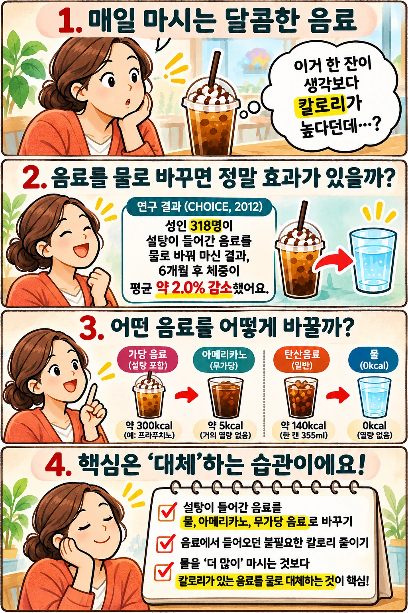

## 매일 마시는 달콤한 한 잔, 바꿔볼까요?

점심을 먹고 달콤한 커피를 마시거나, 저녁에 탄산음료를 곁들이는 게 일상이 된 사람도 많죠. 음료는 가볍게 마시지만 그 안에도 열량이 들어 있어요.

그렇다면 **평소 마시던 달콤한 음료를 물로 바꾸면 체중 관리에 도움이 될까요?**

여기서 중요한 차이가 있어요. **물을 더 마시는 것과 기존 음료를 물로 바꾸는 것은 달라요.** 설탕이 들어간 음료는 그대로 마시면서 물 한 잔을 추가한다고 음료에서 얻는 열량이 줄어들지는 않으니까요.

## 음료를 바꾼 사람들은 얼마나 달라졌을까요?

2012년 발표된 [CHOICE 연구](https://pubmed.ncbi.nlm.nih.gov/22301929/)에서는 과체중·비만 성인 318명을 대상으로 6개월간 음료를 바꾸는 방법을 살펴봤어요.

참가자들은 물이나 다이어트 음료로 하루 200kcal 이상의 열량이 있는 음료를 대체하거나, 식사에서 바꿀 부분을 스스로 선택했어요.

6개월 뒤 평균 체중 감소율은 다음과 같았어요.

- **물로 바꾼 그룹:** 약 2.0%
- **다이어트 음료로 바꾼 그룹:** 약 2.5%
- **식사 습관을 스스로 조절한 그룹:** 약 1.8%

세 그룹 모두 평균적으로 체중이 줄었지만, **그룹 사이의 평균 감량 차이는 통계적으로 유의하지 않았어요.** 물로 바꾸는 방법이 다른 식사 조절보다 무조건 더 뛰어나다고 볼 수는 없는 거죠.

그래도 흥미로운 점은 있어요. 평소 열량 있는 음료를 자주 마셨다면, **한 잔을 다른 음료로 대체하는 것 자체가 실천 가능한 체중 관리 방법**이 될 수 있다는 거예요.

## 어떤 음료부터 바꾸면 좋을까요?

처음부터 좋아하는 음료를 전부 끊을 필요는 없어요. 평소 습관적으로 마시는 한 잔부터 떠올려 보세요.

- **점심 뒤 달콤한 커피:** 시럽을 줄이거나 아메리카노·물로 바꿔보세요.
- **식사와 함께 마시는 탄산음료:** 물이나 무가당 탄산수로 바꿔보세요.
- **매일 마시는 달콤한 음료:** 일주일 중 몇 번만이라도 무가당 음료를 선택해 보세요.

[미국 CDC의 음료 안내](https://www.cdc.gov/healthy-weight-growth/water-healthy-drinks/index.html)에서도 설탕이 들어간 음료 대신 물을 선택하는 방법을 제안하고 있어요.

반대로 우유처럼 단백질과 여러 영양소를 제공하는 음료까지 단순히 열량이 있다는 이유로 모두 없앨 필요는 없어요. **달콤한 음료를 줄이는 것과 영양소를 제공하는 식품을 무조건 피하는 것은 다른 이야기**예요.

## 제로 음료도 괜찮을까요?

달콤한 탄산음료를 갑자기 물로 바꾸기 어렵다면 제로 음료가 대안이 될 수도 있어요.

설탕이 들어간 음료를 열량이 거의 없는 음료로 **대체하면 음료에서 섭취하는 열량을 줄일 수 있어요.** 실제 CHOICE 연구에서도 다이어트 음료로 바꾼 그룹이 포함됐죠.

다만 제로 음료를 마신다고 저절로 살이 빠지는 건 아니에요. 음료를 바꾼 뒤 다른 간식을 더 먹는다면 하루 전체 섭취 열량은 크게 달라지지 않을 수도 있어요. 장기적인 체중 관리 효과도 음료 선택 하나만으로 결정되지는 않아요.

## 오늘 마실 한 잔부터 시작해 보세요

다이어트를 위해 모든 음식을 한꺼번에 바꾸려 하면 부담스러울 수 있어요. 하지만 매일 마시던 달콤한 음료 한 잔을 바꾸는 일은 비교적 쉽게 시작할 수 있죠.

오늘은 시럽이 들어간 커피 대신 아메리카노를, 탄산음료 대신 물을 선택해 보는 건 어떨까요?

**물을 많이 마셔서 살을 빼자는 이야기가 아니에요. 평소 마시던 음료에서 섭취하는 열량을 조금 줄여보자는 거예요.**

작은 변화라도 생활 속에서 꾸준히 이어갈 수 있다면 충분히 의미 있는 시작이에요.

## 참고 자료

- [Tate 등, CHOICE 무작위시험, 2012](https://pubmed.ncbi.nlm.nih.gov/22301929/) — 음료 대체 전략을 비교한 6개월 연구.
- [미국 CDC: 물과 더 건강한 음료 선택](https://www.cdc.gov/healthy-weight-growth/water-healthy-drinks/index.html) — 가당 음료를 물로 대체하는 방법 안내.
