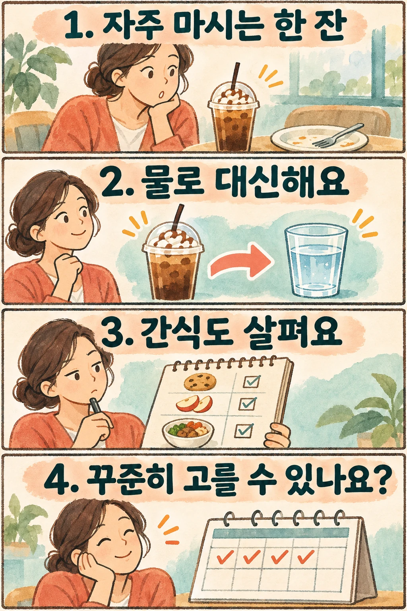

## 물을 더 마시기보다, 어떤 음료를 대신할지 보세요

점심 뒤 달콤한 커피나 저녁 탄산음료를 즐겨 마신다면, 그중 한 잔을 물로 바꾸는 것은 체중 관리를 위해 시도할 수 있는 선택입니다. **기존 음료를 대신해야 음료에서 섭취하던 열량이 줄어듭니다.** 달콤한 음료는 그대로 마시면서 물만 추가하는 것과는 다릅니다.

물에는 열량이 없으므로 가당 음료, 즉 설탕 등을 넣어 달게 만든 음료를 물로 바꾸면 섭취 열량을 줄이는 데 도움이 될 수 있습니다. 다만 이것만으로 체중이 얼마나 줄지는 정할 수 없습니다. 하루 전체의 식사와 활동도 함께 봐야 합니다. [미국 질병통제예방센터(CDC)의 음료 안내](https://www.cdc.gov/healthy-weight-growth/water-healthy-drinks/index.html)도 이러한 교체를 제안합니다.

## 음료를 바꾼 연구에서는 얼마나 달라졌나요?

2012년 발표된 CHOICE 무작위시험은 과체중·비만 성인 318명을 6개월 동안 비교했습니다. 물이나 다이어트 음료로 하루 200kcal 이상의 열량 있는 음료를 대체하는 집단과, 식사에서 바꿀 부분을 스스로 선택하는 비교집단을 두었습니다. 참가자의 84%는 여성이었습니다.

6개월 평균 체중 감소율은 물 집단 약 2.0%, 다이어트 음료 집단 약 2.5%, 비교집단 약 1.8%였습니다. **평균 감량의 집단 간 차이는 통계적으로 유의하지 않았습니다.** 따라서 이 숫자를 근거로 물이 다른 식사 조절보다 우월하다거나, 누구나 같은 비율로 감량한다고 말할 수 없습니다. [정정 사항이 반영된 연구 초록](https://pubmed.ncbi.nlm.nih.gov/22301929/)에서 확인할 수 있습니다.

이 연구는 평소 열량 있는 음료를 마시던 성인의 ‘대체’ 전략을 살펴본 것입니다. 이미 물이나 무가당 차를 주로 마시는 분에게 물을 더 마시라고 권하는 근거는 아닙니다. 6개월의 결과가 그 뒤의 장기 유지까지 보장하지도 않습니다.

## 식사에 필요한 음료와 습관적으로 마시는 음료를 나누세요

먼저 며칠 동안 마시는 음료의 이름과 상황을 적어 보세요. 모든 음료를 없애려 하기보다 ‘없어도 식사를 유지할 수 있는 달콤한 한 잔’을 찾는 용도입니다.

예를 들어 점심 식사를 마친 뒤 습관적으로 사는 시럽 커피와, 아침 식사의 일부로 먹는 우유를 같은 방식으로 다룰 필요는 없습니다. CDC는 우유와 일부 무가당 강화 대체 음료 등을 영양소를 제공하는 음료로 구분합니다. 열량이 있다는 이유만으로 모두 불필요한 음료가 되는 것은 아닙니다.

평소 물이나 무가당 음료를 주로 마신다면 이번 방법을 억지로 적용할 이유가 없습니다. 반대로 하루에 달콤한 음료를 여러 번 마신다면, 가장 쉽게 바꿀 수 있는 시간대 하나부터 고를 수 있습니다. 좋아하는 음료를 전부 금지해야 시작할 수 있는 것도 아닙니다.

## 한 잔을 바꾼 뒤에는 무엇을 확인할까요?

다음은 감량 효과를 보장하는 처방이 아니라, 자신의 생활에 맞는 교체 방법을 찾기 위한 제안입니다.

- **상황을 구체적으로 정하세요.** ‘음료를 줄이겠다’보다 ‘평일 점심 뒤에는 시럽 커피 대신 물을 주문하겠다’처럼 선택할 순간을 정해 보세요.
- **대체 음료를 미리 고르세요.** 물이 무난한 출발점입니다. 물만으로 바꾸기 어렵다면 무가당 차나 첨가당 없는 탄산수처럼 자신이 계속 고를 수 있는 선택지를 살펴보세요.
- **함께 먹는 음식도 기록하세요.** 음료를 바꾼 뒤 허기가 생겨 간식을 추가했는지, 원래 먹던 식사는 유지했는지 적어 보세요. 음료 한 잔의 변화만 보고 하루 전체 섭취가 줄었다고 단정하지 않기 위해서입니다.
- **실제로 이어지는지 보세요.** 물을 주문한 날과 원래 음료를 마신 날을 간단히 표시해 보세요. 자주 되돌아간다면 시간대나 선택지를 바꿔 볼 수 있습니다. 한 번 원래 음료를 골랐다고 식사를 거를 필요는 없습니다.

제로 음료를 고르는 경우에도 ‘무엇을 대신했는지’가 중요합니다. CDC는 대체 감미료가 단기 섭취 열량을 줄일 가능성과 장기 체중 관리 효과의 불확실성을 함께 설명합니다. 제로 음료 자체를 감량 제품으로 기대하거나, 원래 마시던 물을 일부러 바꿀 필요는 없습니다.

## 오래 고를 수 있는 한 잔을 찾으세요

달콤한 음료를 물로 바꾸는 방법은 평소 그 음료를 자주 마시던 분에게 실용적인 출발점이 될 수 있습니다. 핵심은 물의 양을 무작정 늘리는 것이 아니라 **기존 한 잔을 대신하고, 그 뒤 식사와 간식까지 함께 살피는 것**입니다.

체중계 숫자로 바로 성패를 정하기보다 먼저 그 선택을 생활 속에서 이어 갈 수 있는지 확인해 보세요. 이미 음료 습관이 잘 맞는 분이라면 다른 식사나 활동에서 조정할 부분을 찾아도 됩니다.

## 참고 자료

- [CDC: 물과 더 건강한 음료 선택](https://www.cdc.gov/healthy-weight-growth/water-healthy-drinks/index.html) — 음료 대체와 열량, 영양소를 제공하는 음료, 대체 감미료의 장기 효과에 관한 안내입니다.
- [Tate 등, CHOICE 무작위시험, 2012](https://pubmed.ncbi.nlm.nih.gov/22301929/) — 성인의 6개월 음료 교체 연구이며 정정된 초록을 기준으로 평균 감량과 집단 간 차이를 설명했습니다.
