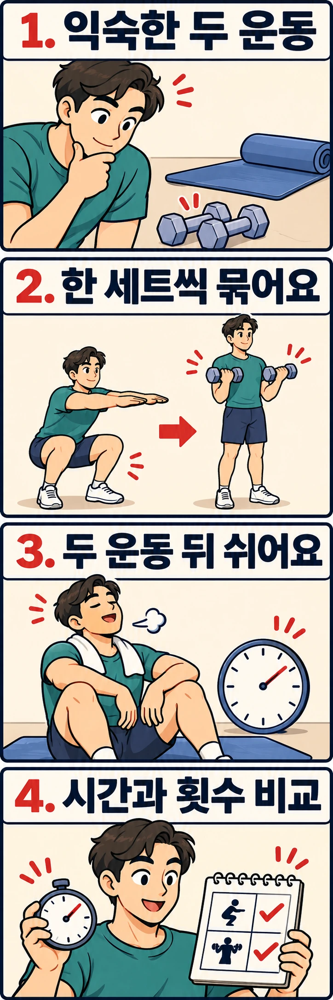

웨이트를 할 시간은 짧은데, 계획한 운동을 모두 하고 싶으신가요? 한 운동의 세트를 전부 끝내기 전에 다른 운동을 끼워 넣는 **슈퍼세트**가 선택지가 될 수 있습니다. 다만 빨리 끝났다는 이유만으로 같은 운동을 온전히 해냈다고 판단하기는 어렵습니다. 두 번째 운동의 반복 수와 동작까지 살펴보셔야 합니다.

## 무엇을 묶고 어디에서 쉬는지부터 정해 보세요

일반 세트는 A 운동을 한 세트 하고 쉰 뒤 A를 다시 하는 방식입니다. 슈퍼세트는 A 한 세트 다음에 B 한 세트를 이어 하고, 그 묶음이 끝난 뒤 쉬는 방식입니다. 운동 사이에는 기구를 안전하게 내려놓고 자세를 잡는 시간이 필요합니다. 전환 속도를 겨루는 방식은 아닙니다.

예를 들어 A와 B를 각각 두 세트 한다면 순서가 이렇게 달라집니다.

| 방식 | 진행 예시 |
| --- | --- |
| 일반 세트 | A → 휴식 → A → 휴식 → B → 휴식 → B |
| 슈퍼세트 | A → B → 휴식 → A → B |

슈퍼세트에서도 A로 돌아오기 전까지 시간이 흐릅니다. 하지만 그 사이 B를 수행하므로, 쉬고만 있는 시간과 같은 조건이라고 보지는 마세요. 같은 무게와 반복 수를 계획해도 실제 수행은 달라질 수 있습니다.

## 연구에서는 빨리 끝났지만 반복 수도 달라졌습니다

[미라우네트 등의 2025년 연구](https://pmc.ncbi.nlm.nih.gov/articles/PMC11782152/)에서는 최근 3개월간 규칙적으로 운동하지 않은 성인 30명이 일반 세트와 슈퍼세트 세션을 모두 수행했습니다. 순서는 무작위로 배정했고, 여덟 운동을 각각 두 세트씩 했습니다. 약 10회 들 수 있는 무게로 더 반복하기 어려울 때까지 수행한 실험이었습니다.

일반 세트에서는 각 세트와 운동 사이에 2분을 쉬었고, 슈퍼세트에서는 두 운동을 연속으로 한 뒤 2분을 쉬었습니다. 평균 소요 시간은 일반 세트 40분, 슈퍼세트 25분이었습니다. 반면 총 반복 수는 각각 158회와 151회였으며, 슈퍼세트에서 스스로 평가한 노력 정도가 더 높았습니다.

이 결과는 해당 조건에서 시간을 줄이면서도 일부 수행량을 포기하는 선택이 생겼다는 뜻입니다. 두 세션을 비교한 연구이므로 몇 달 뒤 근육 성장이나 복싱 실력의 우열을 말해 주지는 않습니다. 아래 제안도 이 실험의 실패 지점까지 드는 방식을 그대로 따라 하는 계획은 아닙니다.

## 처음에는 익숙한 운동 한 쌍만 묶어 보세요

대상은 두 운동을 각각 혼자서 안정적으로 할 수 있는 분입니다. 오늘 목표는 최고 무게를 드는 일이 아니라, **평소 하던 분량을 더 짧은 시간에 무리 없이 마칠 수 있는지 확인하는 것**으로 잡아 보세요. 새 동작을 배우거나 무거운 중량에 도전하는 날에는 세트를 따로 진행하시기를 권합니다.

처음부터 전신 운동 전체를 묶을 필요는 없습니다. 예를 들어 익숙한 **맨몸 스쿼트와 가벼운 덤벨 컬**을 한 쌍으로 선택할 수 있습니다. 컬은 팔꿈치를 굽혀 덤벨을 들어 올리는 운동입니다. 상체와 하체라는 이름만 보고 자동으로 쉬운 조합이라 판단하지 말고, 실제로 연속 수행이 가능한지 확인해 보세요.

다음은 직접 시험해 볼 수 있는 소규모 구성 제안입니다. 연구에서 효과가 검증된 표준 처방은 아닙니다.

1. 가볍게 몸을 움직이고, 두 운동을 각각 적은 횟수로 해 보며 당일 사용할 난도를 정합니다.
2. 스쿼트 8회 뒤에 덤벨 컬 8회를 합니다. 각각 끝났을 때 같은 자세로 몇 회는 더 할 수 있을 만큼 여유를 남깁니다.
3. 두 운동을 마친 뒤 2분을 쉬고 같은 묶음을 한 번 더 합니다. 총량은 각 운동 두 세트입니다.
4. 두 번째 묶음까지 걸린 시간과 각 운동의 실제 반복 수를 적습니다. 준비운동을 시간에 포함했는지도 표시합니다.

2분이 지나도 다음 자세를 차분하게 잡기 어렵다면 더 쉬세요. 첫 시도부터 횟수·무게·묶음 수를 함께 늘리지는 마세요. 덤벨이 없다면 무리하게 다른 운동을 추가하기보다 이미 배운 맨몸 운동 두 가지로 구성을 다시 정하셔도 됩니다. 두 운동이 모두 낯설다면 먼저 따로 익히세요.

## 짧아진 시간과 지킨 수행을 함께 비교하세요

비슷한 컨디션의 다른 날에는 같은 두 운동을 일반 세트로 해 보세요. 무게·목표 횟수·세트 수는 같게 두고 각 세트와 운동 사이에 2분씩 쉬는 식으로 비교할 수 있습니다. 순서와 시간 측정의 시작·끝도 맞춰야 무엇을 바꿨는지 알기 쉽습니다. 하루씩의 비교는 내 구성을 고르는 단서이며 장기 효과를 검증하는 실험은 아닙니다.

| 관찰한 상황 | 다음 선택 |
| --- | --- |
| 시간은 줄고 목표 횟수와 동작을 지켰습니다 | 같은 한 쌍을 유지하며 몇 차례 더 확인합니다. |
| 두 번째 운동에서 몸을 흔들거나 목표 횟수를 채우기 어렵습니다 | 묶음을 해제하고 각각 수행합니다. |
| 더 길게 쉬느라 전체 시간 차이가 거의 없습니다 | 일반 세트를 선택해도 됩니다. |
| 무게 교체와 자리 이동이 번거롭습니다 | 한 자리에서 가능한 익숙한 조합인지 다시 봅니다. |

공용 기구 두 대를 동시에 확보해야만 가능한 조합은 피하세요. 기구를 오가는 시간까지 포함하면 기대한 시간 절약이 사라질 수 있습니다. 기구를 기다리는 사람에게 양보하면서도 가능한 구성을 고르시면 됩니다.

숙련자도 처음부터 모든 운동을 슈퍼세트로 바꾸기보다, 중요한 중량 운동은 따로 끝내고 익숙한 보조 운동 한 쌍만 묶어 보세요. 반복 수가 유지됐더라도 운동 후의 부담 때문에 다음 일정이 계속 흔들린다면 묶음 수를 줄일 이유가 있습니다. 날카로운 통증이나 어지럼이 생기면 해당 시도는 멈추세요.

## 오늘의 선택은 한 쌍이면 충분합니다

시간 절약이 필요하고 익숙한 두 운동을 안정적으로 이어 할 수 있다면 슈퍼세트를 시험해 보세요. 반대로 무게 기록이나 새 동작의 습득이 우선이라면 일반 세트로 여유를 두시는 편이 이번 목표에 맞습니다. 복싱 연습까지 예정돼 있다면 아낀 시간을 추가 운동으로 채우기 전에, 뒤에 할 연습을 수행할 여유가 남았는지도 살펴보세요.

오늘 정할 것은 전체 루틴의 개편이 아닙니다. **묶을 운동 한 쌍, 그대로 둘 분량, 묶음을 풀 기준**을 먼저 정하시면 됩니다. 빨리 끝내기와 계획한 운동을 지키기가 함께 가능했는지 확인한 뒤 다음 구성을 선택해 보세요.

## 참고 자료

- Myraunet PA, Saeterbakken AH, Andersen V (2025). [비훈련 성인의 슈퍼세트와 일반 세트 세션 비교 원저](https://pmc.ncbi.nlm.nih.gov/articles/PMC11782152/). Frontiers in Sports and Active Living. DOI: 10.3389/fspor.2025.1536747. 한 세션의 시간·반복 수·주관적 노력 정도를 비교한 자료입니다.
