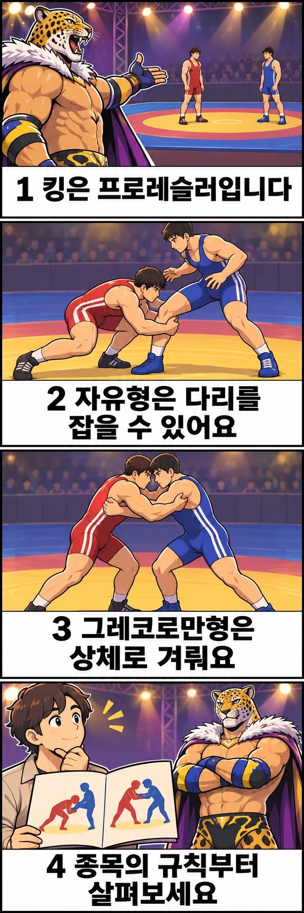

## 킹의 소개에 붙은 종목 이름을 읽어 보세요

철권 8 공식 캐릭터 소개에서 킹의 격투 스타일은 ‘프로레슬링’입니다. 그런데 올림픽 중계에서도 레슬링이라는 이름을 듣습니다. 킹이 속한 분야와 자유형·그레코로만형을 같은 종목 이름처럼 바꿔 불러도 될까요?

이름의 일부는 같지만 그대로 바꿔 읽으면 놓치는 것이 있습니다. 킹의 소개는 **캐릭터가 어떤 무대에서 활동하는지**를 알려 주고, 올림픽 레슬링의 세부 종목은 **어떤 방식으로 상대를 잡고 제어할 수 있는지**를 구분합니다. 이 차이를 알고 보면 캐릭터 설정과 실제 경기를 각각 더 재미있게 읽을 수 있습니다.

## 공식 설정의 킹에게는 관객이 중요합니다

[반다이남코의 킹 소개](https://en.bandainamcoent.eu/tekken/tekken-8/characters/king)는 그가 프로레슬링 무대에서 활동하면서 고아원을 운영한다고 설명합니다. 도움이 필요한 아이들을 위해 자금을 마련해야 하며, 경기장 조명 너머로도 대단한 볼거리를 보여 줘야 한다는 설정도 덧붙입니다.

이 소개를 읽으면 ‘프로레슬링’은 킹이 사용하는 동작의 분류표에 그치지 않습니다. 누구를 위해 싸우며, 왜 사람들의 시선을 모아야 하는지까지 이어 주는 말로 해석할 수 있습니다. 관객 앞에서 존재감을 드러내는 일이 캐릭터의 목적과 연결되는 셈입니다. 이는 공식 소개를 바탕으로 한 해석이며, 특정 기술이 어느 실존 선수에게서 왔다는 뜻은 아닙니다.

따라서 킹을 올림픽 자유형 선수라고 바꿔 부르는 것은 공식 설정과 맞지 않습니다. 반대로 킹의 설정만으로 실제 레슬링 경기의 허용 기술을 짐작하는 것도 어렵습니다. 실제 매트 위에서는 ‘레슬링’ 뒤에 붙은 세부 종목부터 확인해야 합니다.

## 다리를 잡을 수 있는지가 공방의 출발점을 바꿉니다

국제레슬링연맹(UWW)의 [2026년 국제 레슬링 규정 서문](https://cdn.uww.org/2026-01/wrestling_rules.pdf)은 그레코로만형과 자유형의 차이를 먼저 설명합니다. 그레코로만형에서는 상대의 허리선 아래를 잡거나, 상대를 걸어 넘어뜨리거나, 상대에게 다리를 적극적으로 사용해 동작을 수행하는 것이 금지됩니다. 자유형과 여자 레슬링에서는 상대의 다리를 잡고, 걸고, 다리를 적극적으로 사용하는 공격이 허용됩니다.

‘그레코로만형에서는 다리를 쓰지 않는다’는 말은 걷거나 버티기 위해 하체를 사용할 수 없다는 뜻이 아닙니다. 상대를 다리로 걸거나 다리를 공격에 동원하는 행위를 제한한다는 뜻입니다. 자유형 역시 무엇이든 허용하는 싸움이라는 뜻은 아닙니다. 허용 범위 안에서 다리 공격이 선택지에 들어간다는 차이입니다.

이 규칙에서 관전 포인트를 끌어낼 수 있습니다. 자유형을 볼 때는 손이 상대의 다리에 닿을 가능성까지 살펴보세요. 상체에서 손을 다투던 공방도 아래쪽 공격과 연결해 읽을 여지가 있습니다. 그레코로만형에서는 상대의 팔과 몸통을 어떻게 잡는지에 더 주목해 볼 수 있습니다. 이는 규칙에 근거한 관전 제안이지, 모든 선수가 똑같은 자세와 전술을 쓴다는 주장은 아닙니다.

같은 ‘붙잡기’라도 허용되는 목표가 달라지면 경계할 곳도 달라집니다. 킹의 스타일 이름만 보고 현실의 모든 레슬링을 하나로 묶기 어려운 구체적인 이유입니다.

## 넘어뜨린 뒤에는 어깨를 살펴보세요

올림픽 레슬링에서 상대를 넘어뜨리는 것은 중요한 공격이지만, 넘어졌다는 사실만으로 언제나 경기가 끝나지는 않습니다. UWW는 상대의 양어깨를 매트에 제어해 붙이는 승리를 ‘폴’이라고 설명합니다. 2026년 규정 제42조는 심판이 그 자세의 완전한 제어를 확인할 만큼 유지돼야 한다고 정합니다.

여기서 흥미로운 것은 충격의 크기보다 **넘어진 뒤의 자세와 제어**를 읽게 된다는 점입니다. 크게 넘어뜨린 모습을 본 다음에도 상대의 양어깨가 어떻게 놓였는지, 공격자가 제어를 이어 가는지에 시선을 남겨 두세요. 폴이 나오지 않은 경기는 득점으로 승부를 가를 수 있으므로, 넘어뜨리기와 즉시 승리는 구분해서 볼 필요가 있습니다. 이 설명은 올림픽 방식의 레슬링에 관한 것이며, 킹의 게임 내 잡기에 같은 판정 절차가 적용된다는 뜻은 아닙니다.

## 캐릭터의 무대와 선수의 규칙을 따로 읽어 보세요

킹의 공식 소개를 다시 읽을 때는 그가 관객을 모아야 하는 이유를 눈여겨보세요. 프로레슬링이라는 설정이 기술의 분위기뿐 아니라 캐릭터의 삶을 어떻게 설명하는지 보입니다. 실제 레슬링을 볼 때는 순서를 바꿔 보세요. 먼저 자유형인지 그레코로만형인지 확인하고, 허용된 잡기와 넘어뜨린 뒤의 제어를 살펴보는 것입니다.

게임 캐릭터를 실제 선수의 복사본으로 맞춰 볼 필요는 없습니다. 하나의 이름에서 서로 다른 질문을 꺼낼 수 있습니다. 킹에게는 ‘어떤 무대를 보여 주는가’를, 실제 경기에는 ‘어떤 조건에서 상대를 제어하는가’를 물어보시면 됩니다. 그 구분이 잡기 장면을 단순히 화려하다거나 강하다는 감상 너머로 읽게 해 줍니다.

## 참고 자료

- [반다이남코 — 철권 8 킹 공식 소개](https://en.bandainamcoent.eu/tekken/tekken-8/characters/king): 격투 스타일, 프로레슬링 활동과 고아원 관련 캐릭터 설정입니다.
- [UWW — 레슬링 종목 안내](https://uww.org/about-uww/sport): 올림픽 레슬링의 세부 종목, 폴과 득점 승리의 기본 설명입니다.
- [UWW — 2026년 국제 레슬링 규정](https://cdn.uww.org/2026-01/wrestling_rules.pdf): 서문의 종목별 다리 사용 차이와 제42조의 폴 인정 조건을 참고했습니다.
