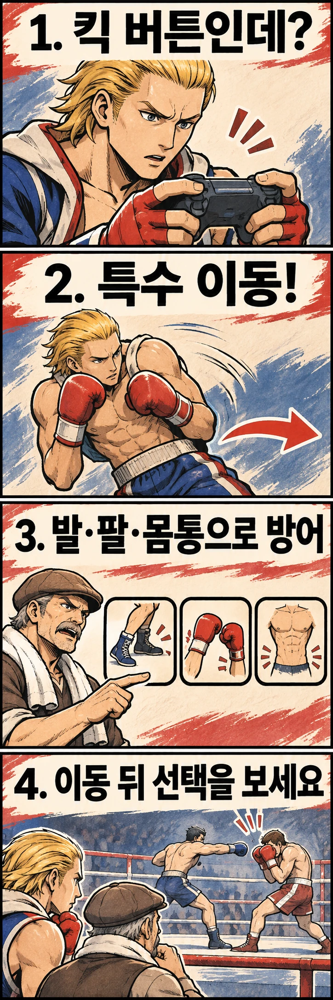

발차기 버튼을 눌렀는데 발이 나오지 않는다면, 조작을 잘못했다고 생각하기 쉽습니다. 그런데 『철권 5』의 스티브 폭스에게는 그것이 캐릭터를 이해하는 입구입니다. 설명서는 스티브에게 일반적인 킥 공격이 없으며, 킥 버튼을 누르면 특수 이동을 한다고 안내합니다.

**공격을 하나 더 넣을 자리에 움직임을 넣으면, 복싱은 어떻게 다르게 보일까요?** 이 글은 『철권 5』 설명서의 조작 설정을 출발점으로 삼습니다. 최신작의 개별 기술 성능이나 추천 콤보를 다루는 공략은 아닙니다.

## 발차기를 빼는 것과 움직임을 넣는 것은 다릅니다

스티브를 단지 ‘주먹만 쓰는 캐릭터’로 이해하면 킥 버튼은 비어 있는 자리처럼 보입니다. 그러나 설명서가 안내하는 것은 버튼의 삭제가 아니라 **다른 행동의 배정**입니다. 같은 입력 장치라도 캐릭터에 따라 플레이어가 내리는 결정이 달라지는 셈입니다.

공식 『철권 8』 캐릭터 소개는 스티브의 격투 스타일을 복싱으로 명시하고, 그를 미들급 복싱 세계 챔피언으로 소개합니다. 이는 작품 속 설정이며, 실제 선수의 경력이나 실존하는 타이틀 기록을 뜻하지 않습니다.

여기서부터는 조작 설계에 대한 해석입니다. 공격 종류를 늘리는 대신 이동에 입력을 쓰게 하면, 플레이어는 ‘무엇으로 때릴까’ 외에 ‘지금 때리지 않고 위치를 바꿀까’라는 질문을 만나게 됩니다. 주먹의 종류뿐 아니라 공방 사이의 움직임도 복싱을 표현하는 재료가 되는 것입니다. 제작진이 이 목적을 밝혔다고 단정하는 것은 아닙니다.

## 실제 복싱의 방어에는 여러 신체 부위가 참여합니다

현실의 복싱을 펀치 목록으로만 보면 방어가 구석으로 밀리기 쉽습니다. 하지만 복싱 스코틀랜드의 지도 자료는 방어를 발, 손·팔, 몸통을 사용하는 범주로 나눕니다. 상대의 펀치가 목표에 도달하지 못하도록 만드는 방법이 하나만 있는 것은 아니라는 뜻입니다.

발로 위치를 옮기는 방어, 손이나 팔로 막거나 흘리는 방어, 몸통을 움직여 피하는 방어는 서로 다른 선택입니다. ‘주먹으로 싸우니 다리는 할 일이 없다’고 볼 수 없는 이유도 여기에 있습니다. 발차기를 하지 않는 상황에서도 발은 위치를 바꾸는 역할을 맡을 수 있습니다.

이 구분을 게임에 그대로 대입해 특수 이동 하나를 실제 기술 하나와 등식으로 연결할 필요는 없습니다. 오히려 **공격 외의 선택에도 조작과 판단이 필요하다**는 점이 연결 고리입니다. 스티브의 특수 이동은 그런 관점으로 캐릭터를 읽게 하는 좋은 출발점입니다.

## 이동 버튼이 있다고 자동으로 안전해지는 것은 아닙니다

게임의 동작에는 입력에 따라 실행되는 정해진 형태가 있습니다. 현실에서는 같은 모양으로 움직여도 상대의 펀치가 향하는 곳과 두 사람의 위치에 따라 결과가 달라집니다. 따라서 화면 속 상체 움직임을 보고 ‘이 자세라면 어떤 공격이든 피한다’는 식으로 이해하면 곤란합니다.

복싱 스코틀랜드의 자료 역시 발을 이용한 방어에서 움직임을 최소화하고, 반격을 시작할 수 있는 안정된 자세를 남기는 것을 강조합니다. 여기서 반격은 상대 공격 뒤에 돌려주는 공격입니다. 방어의 가치는 상대의 주먹이 빗나간 순간뿐 아니라, 그다음에 자신이 무엇을 할 수 있는지와 함께 살펴볼 수 있습니다.

이를 게임 감상에 적용한다면 특수 이동의 크기보다 **이동 전후에 선택이 어떻게 달라지는지**를 보시면 좋습니다. 캐릭터가 공격을 멈추고 움직였을 때 곧바로 펀치를 이어 가는지, 거리를 다시 두는지, 상대가 다른 행동으로 대응하는지에 주목해 보세요. 특정 입력의 성공률이나 유불리를 보장하는 공략이 아니라, 공방을 읽는 관찰 기준입니다.

## 다음에는 주먹이 나오지 않는 순간을 보세요

스티브의 킥 버튼은 복싱을 ‘발차기를 뺀 공격 방식’으로만 볼 때 놓치는 부분을 보여 줍니다. 빈자리를 이동으로 채우면, 때리는 순간 사이에도 플레이어가 선택할 행동이 생깁니다. 이것이 이 글에서 주목한 설계의 재미입니다.

다음에 스티브의 플레이를 보실 때는 연속 펀치 사이에 들어가는 움직임도 함께 살펴보세요. 공격을 추가하지 않은 선택이 다음 공방을 어떻게 바꾸는지 보면, 같은 캐릭터의 싸움도 조금 다르게 읽힐 수 있습니다.

## 참고 자료

- [『철권 5』 북미판 설명서 보존본, 기본 기술의 스티브 예외 안내](https://www.videogamemanual.com/PS2/Tekken%205%20%28USA%29.pdf)
- [반다이남코 공식 『철권 8』 스티브 폭스 소개](https://tekken.com/fighters/steve-fox)
- [복싱 스코틀랜드 지도 자료: 발·손과 팔·몸통을 사용하는 방어](https://www.boxingscotlandtoolkit.org/session-delivery/defence-use-trunk-defence-if-no-use-of-lower-body-etc/)
