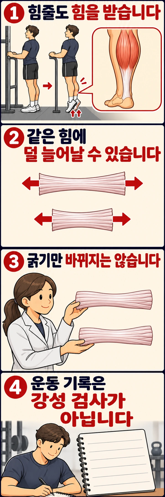

뒤꿈치를 드는 운동을 할 때 종아리 근육은 수축하고, 아킬레스건은 그 힘을 발뒤꿈치에 전달합니다. 근력운동을 반복하면 근육뿐 아니라 이 연결 조직도 달라질까요? **힘줄도 훈련에 적응하며, 연구에서는 얼마나 굵어졌는지와 같은 힘에 얼마나 늘어나는지를 나눠 살펴봅니다.**

## 힘줄은 힘을 전달하면서 늘어납니다

힘줄은 근육과 뼈를 연결하는 조직입니다. 근육이 당기면 힘줄에도 장력이 걸립니다. 힘줄은 길이가 완전히 고정된 막대가 아니어서, 힘을 받으면 조금 늘어납니다. 이때 탄성 에너지를 저장했다가 되돌려 줄 수도 있습니다.

여기서 **강성**은 힘이 증가할 때 늘어나는 길이에 비해 힘이 얼마나 크게 증가하는지를 나타냅니다. 같은 힘 범위에서 비교할 때 강성이 높은 힘줄은 덜 늘어납니다. 이는 연구에서 측정하는 기계적 성질이며, 아침에 몸이 뻣뻣하다고 느끼는 감각과는 다릅니다. [힘줄 기능과 적응에 관한 문헌고찰](https://pmc.ncbi.nlm.nih.gov/articles/PMC4532714/)

따라서 ‘힘줄 강성이 높아졌다’는 결과를 ‘유연성이 나빠졌다’로 바꿔 읽으면 안 됩니다. 관절이 얼마나 움직이는지, 몸이 어떻게 느껴지는지, 특정 힘줄이 힘을 받을 때 얼마나 늘어나는지는 서로 다른 질문입니다.

## 굵기와 재료의 성질은 어떻게 다를까요?

힘줄이 굵어지면 힘을 나누어 받는 단면적이 커집니다. 하지만 강성 변화에는 굵기 외에 **재료 자체가 변형에 저항하는 정도**도 관여합니다. 연구에서는 이를 탄성계수로 구분합니다. 강성이 힘줄 전체의 반응이라면, 탄성계수는 길이와 단면적의 영향을 고려해 재료의 성질을 살펴보는 지표입니다.

힘줄을 구성하는 콜라겐은 당기는 힘을 견디는 단백질입니다. 반복적인 부하에 대한 적응에는 콜라겐 합성뿐 아니라 섬유 구조와 분자 사이 연결의 변화도 관련될 수 있습니다. 다만 몸 안에서 측정한 강성이 높아졌다는 결과만으로 어느 분자 과정이 얼마나 기여했는지까지 확정할 수는 없습니다. [적응 기전의 구분](https://pmc.ncbi.nlm.nih.gov/articles/PMC4532714/)

2022년 라자르추크 연구진의 체계적 문헌고찰·메타분석은 건강한 하지 힘줄을 다룬 61개 논문, 참가자 763명의 자료를 모았습니다. 전체적으로 부하 훈련 뒤 강성·탄성계수·단면적의 증가가 관찰됐습니다. 세 지표를 함께 측정한 연구들의 분석에서는 강성 증가가 단면적보다 탄성계수 변화와 더 강하게 연결됐습니다. **겉으로 굵어지는 변화만으로 힘줄의 적응을 설명하기는 어렵다는 뜻입니다.** [2022년 연구 원문](https://link.springer.com/article/10.1007/s40279-022-01695-y)

## 같은 운동량이면 자극도 같을까요?

힘줄이 받는 자극에는 힘의 크기뿐 아니라 힘을 받는 시간과 반복 방식도 포함됩니다. 무게와 총 반복 횟수만 같다고 조직이 겪는 변형이 같아지는 것은 아닙니다.

뵘 연구진의 2014년 연구는 아킬레스건에 가하는 자극을 달리해 14주 동안 주 4회 훈련했습니다. 기준 조건은 3초 부하와 3초 이완을 반복했고, 비교 조건은 한 번에 12초 부하를 주거나 한 발 점프를 했습니다. 힘줄의 변형 크기와 부하량을 비슷하게 맞춘 실험이었습니다.

기준 조건과 12초 조건에서 강성과 탄성계수가 유의하게 증가했고, 기준 조건의 증가가 더 컸습니다. 점프 조건에서는 강성 증가가 통계적 유의성에 이르지 않았습니다. 이 결과는 자극을 가하는 방식이 중요할 수 있음을 보여 줍니다. 다만 **점프가 무용하다거나 모든 사람에게 3초가 최적이라는 결론은 아닙니다.** 실험 장비로 부하를 통제한 아킬레스건 연구를 일반 운동 전체에 그대로 적용할 수는 없습니다. [연구 초록과 실험 조건](https://pubmed.ncbi.nlm.nih.gov/25267851/)

## 연구에서 아직 정해 주지 못하는 것은 무엇일까요?

2015년 메타분석은 건강한 18~50세의 8주 이상 훈련 연구를 대상으로 했고, 아킬레스건과 무릎 앞쪽 슬개건을 다뤘습니다. 이 범위의 결과를 손목·어깨 힘줄이나 통증이 있는 사람의 재활에 바로 옮길 수는 없습니다. [연구의 포함 기준](https://pmc.ncbi.nlm.nih.gov/articles/PMC4532714/)

2022년 문헌고찰 역시 연구마다 운동 방식과 측정 조건이 달랐습니다. 여러 연구의 평균 변화는 한 사람의 적응 완료 시점이나 필요한 무게를 정해 주지 않습니다. 탄성계수와 강성의 관련성도 특정 분자 기전을 직접 증명한 것은 아닙니다.

또한 강성은 파열에 견디는 최대 힘을 직접 측정한 값이 아닙니다. 강성이 증가했다는 연구 결과만으로 부상 예방이나 복싱 펀치의 향상이 입증됐다고 말할 수 없습니다.

## 운동 기록에는 무엇을 남기면 좋을까요?

연구의 원리를 일상 운동에 적용한다면, 우선 어떤 부하를 반복해서 주고 있는지 구분하는 일이 현실적입니다. 다음은 힘줄 훈련 처방이 아니라 기록 방법의 예시입니다.

평소 하던 뒤꿈치 들기를 기록한다면 무게와 횟수 옆에 무릎을 편 상태인지, 지지대를 잡았는지, 뒤꿈치를 어느 높이까지 들었는지, 반동을 썼는지를 함께 적어 보세요. 다음 운동에서는 그 조건을 유지하며 비교합니다. 무게를 늘리면서 동작 범위와 속도까지 바꾸면 어떤 자극이 달라졌는지 해석하기 어렵습니다.

반복 횟수가 늘었다면 그 동작의 수행능력이 나아졌다는 기록은 남길 수 있습니다. 그러나 그 증가분을 힘줄 적응의 몫으로 계산할 수는 없습니다. 연구에서는 힘을 측정하는 장비와 초음파 등을 함께 사용해 힘줄이 늘어나는 정도를 평가합니다. 손으로 만져 보거나 운동 기록만 보는 방식은 그 측정을 대신하지 못합니다.

새로 생긴 국소 통증을 강성이 높아지는 신호로 해석해 부하를 올리지는 마세요. 이 글의 근거는 건강한 힘줄의 적응에 관한 것이며, 통증을 평가하는 기준과는 구분해야 합니다.

처음의 질문으로 돌아가면, 뒤꿈치를 들 때 힘을 전달하던 힘줄도 반복 훈련에 적응할 수 있습니다. 그 변화는 굵기만이 아니라 같은 힘에서 늘어나는 정도에도 나타납니다. 다음 운동에서는 힘줄을 만져 변화를 판정하기보다, **어떤 자세와 부하를 반복했는지** 남겨 보세요. 눈에 보이는 근육 크기만으로는 다 담기지 않는 적응을 이해하는 출발점입니다.

## 참고 자료

- Bohm S, Mersmann F, Arampatzis A (2015). *Human tendon adaptation in response to mechanical loading: a systematic review and meta-analysis of exercise intervention studies on healthy adults*. [공개 원문](https://pmc.ncbi.nlm.nih.gov/articles/PMC4532714/). DOI: 10.1186/s40798-015-0009-9.
- Lazarczuk SL 외 (2022). *Mechanical, Material and Morphological Adaptations of Healthy Lower Limb Tendons to Mechanical Loading: A Systematic Review and Meta-Analysis*. [학술지 원문](https://link.springer.com/article/10.1007/s40279-022-01695-y). DOI: 10.1007/s40279-022-01695-y.
- Bohm S, Mersmann F, Tettke M, Kraft M, Arampatzis A (2014). *Human Achilles tendon plasticity in response to cyclic strain: effect of rate and duration*. [논문 정보와 초록](https://pubmed.ncbi.nlm.nih.gov/25267851/). DOI: 10.1242/jeb.112268.
