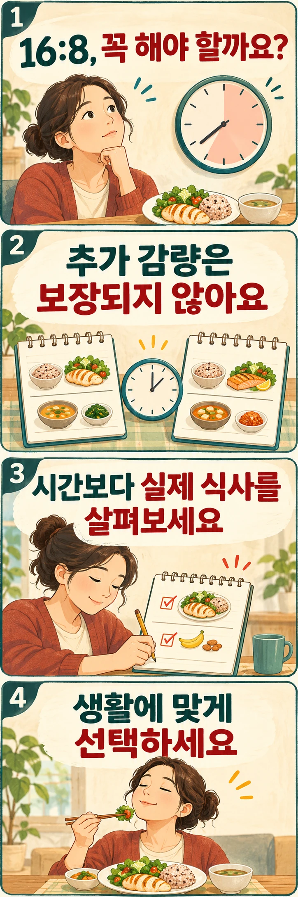

## 식사량을 조절하는데 공복 시간도 늘려야 할까요?

체중을 줄이기 위해 누구나 16:8 간헐적 단식을 해야 하는 것은 아닙니다. 하루 중 8시간 안에 식사하고 나머지 16시간은 공복으로 보내는 방식이지만, 그 시간표 자체가 감량의 필수 조건은 아닙니다. 이미 식사량을 조절하고 있다면 공복 시간을 더하는 것이 어떤 도움을 주는지 따로 판단하셔야 합니다.

시간제한 식사는 식사 관리를 단순하게 만드는 선택지가 될 수 있습니다. 반대로 정해진 시간에 맞추느라 필요한 식사를 자꾸 거르거나 다음 끼니를 몰아 먹는다면 다른 방식이 생활에 더 잘 맞을 수 있습니다.

## 같은 식사량 조절에 시간표를 더한 시험에서는 어땠을까요?

2022년 발표된 무작위시험은 비만이 있는 139명을 두 집단에 배정했습니다. 두 집단 모두 열량을 제한하도록 안내받았고, 한 집단만 오전 8시부터 오후 4시 사이에 먹도록 했습니다. 12개월 뒤 평균 체중 변화는 시간제한 집단에서 −8.0kg, 열량 제한만 한 집단에서 −6.3kg이었습니다. 그러나 집단 간 차이는 통계적으로 유의하지 않았습니다. 체지방 감소에서도 시간제한의 추가 이점이 확인되지 않았습니다. [Liu 등의 연구 초록](https://pubmed.ncbi.nlm.nih.gov/35443107/)

평균 숫자가 다르다고 추가 효과가 입증된 것은 아닙니다. 그렇다고 두 방식이 모든 사람에게 정확히 같다는 뜻도 아닙니다. 이 시험은 특정 대상과 시간대에서 얻은 결과이므로, 모든 간헐적 단식 방식이나 개인의 반응으로 넓혀 해석하기는 어렵습니다. 연구에서 사용한 식사량과 시간표를 개인의 처방처럼 따라 할 필요도 없습니다.

## 칼로리를 세는 대신 시간을 정하면 어떨까요?

이번에는 질문이 다릅니다. 식사량 조절에 규칙을 하나 더 얹는 대신, 매번 열량을 계산하는 방법을 시간표로 바꿔 보는 경우입니다.

2023년 발표된 또 다른 12개월 무작위시험은 비만이 있는 성인 90명을 시간제한 식사, 매일 열량 제한, 대조군으로 나눴습니다. 첫 6개월에는 시간제한 집단이 열량 계산 없이 정오부터 오후 8시까지 먹었고, 열량 제한 집단은 하루 섭취 열량을 25% 줄이도록 했습니다. 이후 6개월은 유지 단계로, 시간제한 집단은 식사 시간을 10시간으로 넓혔고 열량 제한 집단도 유지에 필요한 식사량을 안내받았습니다. 대조군과 비교한 12개월 체중 감소는 각각 약 4.6kg과 5.4kg이었으며, 두 전략 사이의 차이는 통계적으로 유의하지 않았습니다. [Lin 등의 연구](https://pmc.ncbi.nlm.nih.gov/articles/PMC11192144/)

이 시험에서는 두 집단 모두 보고된 섭취 열량이 줄었습니다. 시간을 정하는 방법도 실제 먹는 양의 변화와 함께 해석해야 합니다. ‘8시간 안에는 얼마든지 먹어도 같은 결과가 난다’는 보장은 아닙니다. 영양사 상담이 함께 제공됐고, 집단 평균은 내 감량 예상치가 아닙니다. 두 시험의 감량 숫자를 직접 비교해 오전 식사와 오후 식사 중 어느 쪽이 우월하다고 결론 내려서도 안 됩니다. 대상과 비교 조건이 서로 다르기 때문입니다.

## 내 생활에서는 어떤 점을 확인하면 좋을까요?

공복 시간을 늘리기 전에 평소 식사가 어떻게 이어지는지 적어 보세요. 정확한 열량 계산표가 아니어도 됩니다. 첫 식사와 마지막 식사 시각, 중간에 먹은 간식·음료, 배고픔이 크게 느껴진 때를 함께 남기면 시간표가 해결할 문제가 보입니다.

- **저녁 식사 뒤 습관적으로 간식을 드신다면:** 하루 식사 전체를 8시간으로 압축하기 전에, 저녁 뒤 간식을 먹는 상황부터 살펴보세요. 배고픔 때문인지, 일을 마친 뒤 늘 먹는 습관인지 구분해 바꿀 부분을 정할 수 있습니다.
- **아침 식사가 일과에 잘 맞는다면:** 16시간을 채우기 위해 무조건 아침을 없애지 않으셔도 됩니다. 현재 식사를 유지하면서 양과 구성을 조절하는 선택도 있습니다.
- **퇴근과 운동 시간이 늦다면:** 종료 시각 때문에 저녁 식사를 계속 건너뛰는지 확인해 보세요. 시간 규칙을 지킨 횟수뿐 아니라 실제로 식사를 어떻게 하고 있는지가 판단 기준입니다.
- **제한 시간이 끝나기 전에 몰아 드신다면:** ‘지금 안 먹으면 못 먹는다’는 생각 때문에 식사가 커지는지 살펴보세요. 더 좁은 시간표를 만들기보다 규칙을 완화하거나 다른 관리 방식을 고려할 이유가 됩니다.

이 기록은 진단 도구나 감량 보장 계획이 아닙니다. 내 생활에서 규칙이 무엇을 바꾸는지 알아보기 위한 방법입니다. 시간을 줄였다는 사실만 확인하기보다, 식사가 편해졌는지와 먹는 양이 어떻게 달라졌는지를 함께 보세요.

당뇨병이 있고 인슐린 등 혈당을 낮추는 약을 사용한다면 식사 간격을 임의로 늘리기 전에 의료진과 상의하셔야 합니다. 약을 계속 사용하는 상태에서 단식하면 저혈당 위험이 높아질 수 있습니다. 약의 용량이나 복용 시각도 스스로 바꾸지 마세요. [미국 NIDDK의 저혈당 안내](https://www.niddk.nih.gov/health-information/diabetes/overview/preventing-problems/low-blood-glucose-hypoglycemia)

## 시간을 지키는 것보다 내게 맞는 선택인지 보세요

16:8은 감량을 시작하기 위한 통과 조건이 아닙니다. 식사 선택을 단순하게 해 준다면 고려할 수 있지만, 이미 잘 맞는 식사 방식에 의무적으로 더할 규칙은 아닙니다. 공복 시간을 얼마나 길게 채웠는지보다, 그 시간표가 실제 식사와 생활을 어떻게 바꾸는지 확인하고 선택해 보세요.
