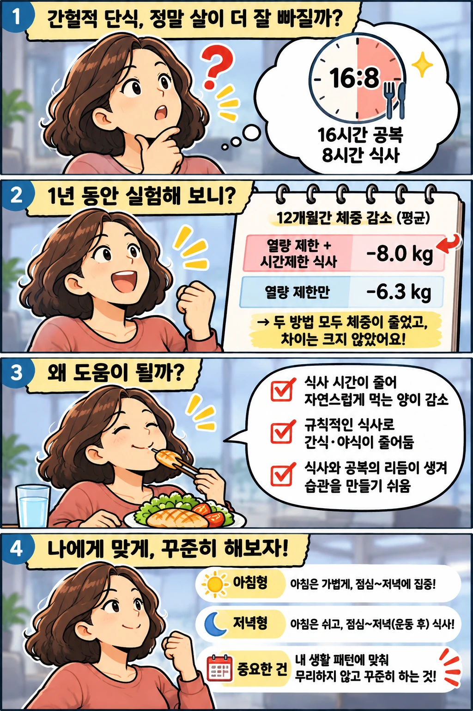

## 아침을 굶으면 살이 더 잘 빠질까요?

다이어트를 시작하면 한 번쯤 듣게 되는 말이 있죠. “16시간만 굶어 봐!”

하루 24시간 중 8시간 안에 식사를 마치고 나머지 16시간은 공복으로 보내는 **16:8 간헐적 단식** 이야기예요. 예를 들어 낮 12시에 첫 끼를 먹고 저녁 8시 전에 마지막 식사를 끝내는 방식이죠.

식사 시간을 정하면 야식이나 군것질을 줄이는 데 도움이 될 수 있어요. 그런데 궁금해져요. **같은 양을 먹더라도 16시간을 굶으면 살이 더 잘 빠질까요?**

## 1년 동안 실험해 보니 어땠을까요?

2022년 [Liu 연구진의 실험](https://pubmed.ncbi.nlm.nih.gov/35443107/)에서는 비만이 있는 성인 139명을 두 그룹으로 나눴어요. 두 그룹 모두 식사 열량을 제한했고, 한 그룹만 오전 8시부터 오후 4시까지 식사하도록 했죠.

12개월 뒤 시간제한 식사를 병행한 그룹은 평균 **8.0kg**, 식사량만 조절한 그룹은 **6.3kg** 줄었어요. 숫자로는 차이가 있었지만, 연구에서는 **통계적으로 유의한 차이가 확인되지 않았어요.** 공복 시간을 더 길게 확보하는 것만으로 추가 감량 효과가 확실해졌다고 보기는 어렵다는 거예요.

그럼 칼로리를 일일이 계산하는 대신 먹는 시간만 정하면 어떨까요?

2023년 [Lin 연구진의 실험](https://pmc.ncbi.nlm.nih.gov/articles/PMC11192144/)에서는 비만이 있는 성인 90명을 대상으로 시간제한 식사와 일반적인 열량 제한을 비교했어요. 시간제한 식사 그룹은 처음 6개월간 낮 12시부터 저녁 8시 사이에 먹었고, 이후에는 식사 가능 시간을 10시간으로 늘렸어요.

12개월 뒤 대조군과 비교한 체중 감소는 시간제한 식사 그룹이 약 **4.6kg**, 열량 제한 그룹이 약 **5.4kg**이었어요. 이번에도 두 방법 사이에 통계적으로 유의한 차이는 확인되지 않았죠.

두 연구가 보여주는 공통점은 분명해요. **간헐적 단식도 체중 관리에 활용할 수 있지만, 일반적인 식사량 조절보다 무조건 더 효과적인 방법은 아니라는 것**이에요.

## 간헐적 단식이 도움이 되는 이유는 뭘까요?

간헐적 단식의 장점 중 하나는 규칙이 단순하다는 거예요. 무엇을 몇 칼로리 먹었는지 매번 계산하는 대신, 먹는 시간을 정해둘 수 있으니까요.

예를 들어 저녁을 먹고도 습관적으로 과자나 야식을 찾는 사람이라면 식사 종료 시간을 정하는 것만으로 간식이 줄어들 수 있어요. 실제로 2023년 연구에서도 시간제한 식사 그룹의 섭취 열량이 감소했어요.

하지만 **8시간 안에 먹기만 하면 양은 상관없다는 뜻은 아니에요.** 제한된 시간에 평소보다 많이 먹는다면 체중 관리에 도움이 되기 어렵겠죠.

결국 중요한 건 단식 시간을 몇 시간 채웠는지뿐 아니라, 그 과정에서 실제 식사 습관과 섭취량이 어떻게 달라졌는지예요.

## 나에게 맞는 방법을 선택해 봐요

간헐적 단식이 편한 사람도 있고, 오히려 불편한 사람도 있어요. 자신의 생활을 떠올려 보세요.

- **저녁마다 야식이 고민이라면** 마지막 식사 시간을 정해보는 것도 좋아요. 꼭 처음부터 16시간 공복을 목표로 할 필요는 없어요.
- **아침을 먹어야 하루가 편하다면** 억지로 아침을 거르지 않아도 돼요. 평소 식사 시간을 유지하며 양과 구성을 조절해도 괜찮아요.
- **저녁에 운동한다면** 운동 후 식사까지 무조건 건너뛰지 않도록 생활에 맞는 시간대를 선택해 보세요.
- **공복 뒤 폭식하게 된다면** 시간을 더 줄이기보다 자신에게 맞는 다른 식사 관리 방법을 찾아보는 편이 좋아요.

한 가지 주의할 점도 있어요. **당뇨병으로 인슐린이나 저혈당을 일으킬 수 있는 약을 사용한다면**, 식사 간격을 늘리기 전에 의료진과 상의해야 해요. 단식 중 저혈당 위험이 생길 수 있으니 약의 용량이나 복용 시간도 스스로 바꾸지 마세요. [미국 NIDDK 안내](https://www.niddk.nih.gov/health-information/diabetes/overview/preventing-problems/low-blood-glucose-hypoglycemia)

## 시계보다 중요한 건 꾸준히 이어갈 수 있는 식사예요

간헐적 단식은 다이어트의 필수 조건이 아니라 여러 방법 중 하나예요.

먹는 시간을 정하는 게 편하고 자연스럽게 간식이 줄어든다면 시도해 볼 만해요. 반대로 배고픔 때문에 일상이 힘들거나 식사 시간이 스트레스가 된다면 굳이 고집할 이유는 없어요.

**16시간을 채우는 것보다 나에게 맞는 식사 습관을 오래 이어가는 것.** 그게 더 중요한 목표예요.
