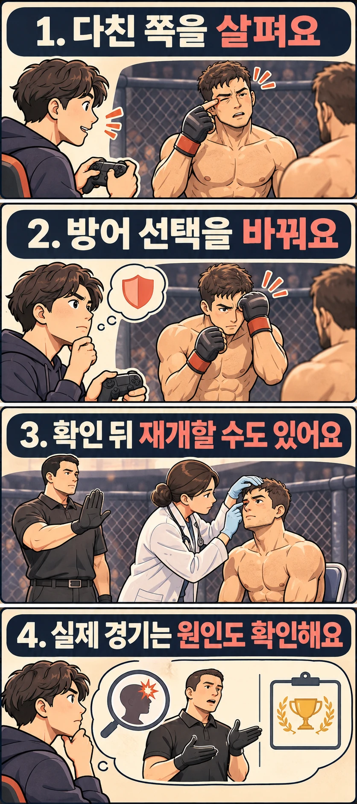

UFC 5에서는 상대를 쓰러뜨리는 것만 생각하다가 뜻밖의 변수를 만날 수 있습니다. 부상이 쌓이면 심판이 의사를 불러 상태를 확인하고, 닥터 스톱으로 경기가 끝날 수도 있기 때문입니다. 그렇다면 이 기능은 단지 긴장감을 높이는 이벤트일까요? 부상을 입은 뒤에도 같은 방식으로 싸울지를 묻는 장치로 보면 게임과 실제 종합격투기가 함께 흥미로워집니다.

## 얼굴의 변화가 다음 선택에 영향을 줍니다

EA의 [UFC 5 공식 게임플레이 설명](https://www.ea.com/games/ufc/ufc-5/news/ufc-5-gameplay)은 ‘리얼 임팩트 시스템’을 소개합니다. 베인 상처와 멍, 부기가 부위별로 누적되고 게임 진행에 영향을 주는 시스템입니다. 같은 자료는 심한 손상이 생기면 심판이 의사의 확인을 요청할 수 있으며, 재개 후에는 다친 부위를 보호하는 방어 전략이 필요하다고 설명합니다.

이 설계에서 눈여겨볼 점은 **지금 공격할 기회와 이후에도 공방을 이어갈 여건이 서로 다르다**는 것입니다. 예를 들어 게임에서 공격을 더 이어가고 싶어도, 같은 부위를 계속 내주고 있다면 방어 선택을 바꿀 이유가 생깁니다. 이는 특정 플레이 장면의 재현이 아니라 공식 기능 설명에서 읽을 수 있는 전술적 의미입니다.

게임을 할 때는 ‘상대에게 얼마나 더 맞힐까?’와 함께 ‘내가 어느 쪽을 계속 내주고 있나?’를 살펴보세요. 이 질문은 단순히 뒤로 물러나라는 뜻이 아닙니다. 공격을 시작할 때와 끝낼 때, 같은 빈틈이 반복되는지를 보는 관점입니다. 닥터 스톱이 나오기 직전의 한 순간보다 그 전에 누적된 선택에 관심을 두게 됩니다.

## 의사가 들어오는 순간과 경기 종료는 구분해야 합니다

게임에서도 의사의 확인을 거친 뒤 경기가 재개될 수 있습니다. 따라서 ‘의사가 들어왔다’는 사실과 ‘경기가 끝났다’는 결과를 같은 뜻으로 읽으면 곤란합니다. 확인은 계속할 수 있는지를 판단하는 과정이고, 종료는 그 판단 뒤의 결과입니다.

현실의 MMA에서도 경기 종료 권한과 의료적 판단을 나누어 이해할 필요가 있습니다. [ABC의 2024년 개정 통합규칙](https://www.abcboxing.com/wp-content/uploads/2024/07/unified-mma-rules-rev-july-2024.pdf)은 심판을 경기 중단 권한이 있는 유일한 사람으로 명시합니다. 동시에 결과 분류에는 TKO, 즉 기술적 녹아웃의 의료적 중단 항목으로 열상과 닥터 스톱을 둡니다. 열상은 피부가 찢어진 상처를 뜻합니다.

따라서 닥터 스톱을 ‘의사가 선수의 패배를 마음대로 선언하는 것’으로 이해하기보다, 의료적 이유가 경기 종료에 반영되는 절차로 읽는 편이 정확합니다. 이 글의 규칙 비교는 해당 ABC 문서를 기준으로 하며, 개별 대회는 관할 기구가 적용하는 규정을 확인해야 합니다.

## 상처가 보이면 생긴 원인부터 살펴보세요

실제 경기를 보면서 ‘피가 나니까 곧 TKO겠네’라고 결과를 먼저 정하지는 마세요. 같은 상처처럼 보여도 합법적인 공격으로 생겼는지, 반칙과 관련됐는지가 다를 수 있습니다. ABC 규칙은 고의 반칙과 우발적 반칙으로 인한 부상에 별도 결과 규정을 두고 있습니다. 의료적 이유로 더 싸울 수 없다는 사실만으로 승패 처리까지 모두 설명되지는 않습니다.

관전할 때는 먼저 **직전 동작과 심판의 설명**, 그다음 **의료적 확인 뒤 재개 여부**, 마지막으로 **공식 결과**를 순서대로 살펴보세요. 중계 화면만으로 상처의 깊이나 선수의 상태를 진단하려 할 필요는 없습니다. 보이는 손상과 경기 운영상의 결정을 구분하는 것만으로도 중단 장면을 더 차분하게 읽을 수 있습니다.

여기서 게임과 현실을 연결하는 기준도 분명해집니다. 게임은 부상에 따른 선택을 플레이어가 읽고 대응하도록 규칙화합니다. 현실의 의료적 판단을 게임의 표시나 반복 횟수로 환산할 수는 없습니다. 게임에서 익숙해진 것은 상처의 판정 공식이 아니라, 경기에는 ‘공격을 계속할 수 있는 조건’도 있다는 관점입니다.

## 다음에는 멈춘 뒤의 공방을 보세요

닥터 확인 뒤 재개된 게임에서는 다친 쪽을 보호하려는 선택이 어떻게 바뀌는지 살펴보세요. 실제 경기라면 선수의 변화와 함께 심판의 지시, 공식 결과를 나란히 보시면 좋습니다. 누가 더 강하게 때렸는지에만 집중할 때 놓쳤던 경기 운영이 드러납니다.

UFC 5의 이 기능을 흥미롭게 읽는 방법은 부상을 더 사실적으로 그렸는지만 평가하는 데서 한 걸음 나아가는 것입니다. **경기를 계속하는 일 자체가 다음 공방의 조건**이라는 점을 떠올리면, 잠시 멈춘 시간도 승부의 일부로 보이기 시작합니다.

## 참고 자료

- [EA SPORTS UFC 5 — Gameplay Deep Dive](https://www.ea.com/games/ufc/ufc-5/news/ufc-5-gameplay): 부상 시스템, 의사의 확인과 경기 재개 후 방어 전략에 관한 공식 설명입니다.
- [ABC — Unified Rules of Mixed Martial Arts, 2024년 개정](https://www.abcboxing.com/wp-content/uploads/2024/07/unified-mma-rules-rev-july-2024.pdf): 심판 권한은 1쪽, 반칙에 따른 부상 처리는 5~6쪽, 의료적 TKO 분류는 8쪽에 있습니다.
