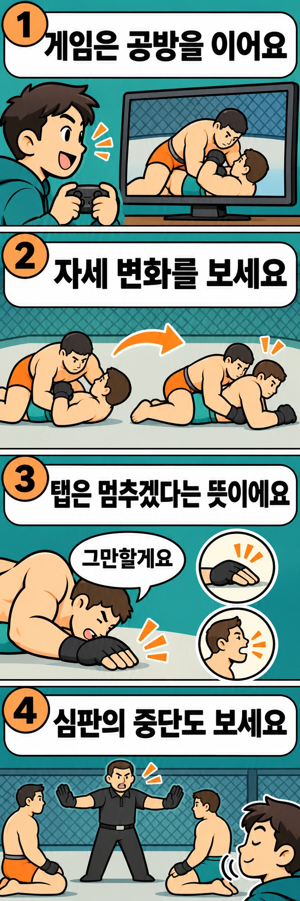

격투기 게임에서 주먹을 주고받던 두 선수가 바닥으로 내려갑니다. 처음 보는 분이라면 때리는 동작보다 서로 붙잡고 버티는 모습이 더 어렵게 느껴질 수 있습니다. 무엇을 해야 유리해지고, 어느 순간 승부가 끝나는 걸까요?

게임 **UFC 5는 서브미션의 별도 미니게임을 없애고 기존 붙잡기 시스템에 연결했습니다.** 서브미션은 관절기나 조르기 등으로 상대의 항복을 이끌어 내는 기술을 말합니다. 이 변화에서 출발해, 붙잡기 공방의 흐름과 실제 경기의 종료 신호를 살펴보겠습니다.

## 별도 과제에서 이어지는 공방으로 바뀌었습니다

EA는 UFC 5의 개편된 기능을 ‘심리스 서브미션’으로 소개합니다. 여기서 심리스는 흐름이 끊기지 않고 이어진다는 뜻입니다. 공식 설명의 핵심은 기존 그래플링 시스템을 확장하고, 애니메이션을 빠르게 연결하며, 미니게임을 제거했다는 점입니다. 그래플링은 상대를 붙잡고 자세와 움직임을 다투는 공방입니다.

따라서 이 변화를 ‘서브미션이 쉬워졌다’고만 이해할 필요는 없습니다. 별도 미니게임의 과제를 수행하는 대신, 앞서 진행하던 붙잡기 공방 속에서 서브미션을 받아들이게 된 변화로 볼 수 있습니다. 이는 시스템 구성에 대한 해석이며, 모든 플레이어가 더 쉽거나 더 사실적으로 느낀다는 뜻은 아닙니다.

게임을 처음 접한다면 기술 이름을 한꺼번에 외우기보다, 서브미션에 들어가기 전후로 두 캐릭터의 위치가 어떻게 달라지는지 살펴보세요. ‘어떤 기술을 골랐는가’에 ‘어떤 자세에서 이어졌는가’라는 질문을 더하는 방법입니다.

## 현실 경기는 게임의 성공 판정과 무엇이 다를까요?

게임은 입력과 정해진 시스템으로 공방을 처리합니다. 실제 종합격투기에서는 선수가 보내는 신호와 심판의 판단이 경기 종료에 관여합니다. 화면 속 기술이 완성된 듯 보인다는 이유만으로 현실의 승패를 미리 정할 수는 없습니다.

ABC 종합격투기 통합 규칙의 경기 결과 항목은 신체로 더 이상 계속하지 않겠다는 뜻을 표시하는 탭 아웃과, 말이나 고통을 나타내는 소리로 뜻을 전하는 구두 탭 아웃을 규정합니다. 손으로 두드리는 모습만 찾아서는 종료 신호를 놓칠 수 있는 이유입니다.

관전할 때는 탭이 나온 직후 심판이 어떻게 개입하는지도 함께 보세요. 통합 규칙은 경기 중단 권한을 심판에게 둡니다. 선수의 항복 표시와 심판의 중단은 함께 살펴볼 서로 다른 요소입니다. 여기서는 ABC 통합 규칙을 기준으로 설명하며, 개별 대회에 적용되는 규정은 별도로 확인해야 합니다.

## 탭이 안 보였는데 끝나는 경우도 있습니다

모든 서브미션 결과가 눈에 띄는 탭으로 끝나는 것은 아닙니다. 통합 규칙은 합법적인 서브미션으로 의식을 잃거나 골절·탈구가 발생한 경우를 ‘테크니컬 서브미션’으로 구분합니다. 탭을 했는지와 어떤 결과로 경기가 중단됐는지는 같은 질문이 아닙니다.

그렇다고 관객이 멀리서 본 자세만으로 의식이나 부상 상태를 진단할 수는 없습니다. 탭이 화면에 잡히지 않았다면 먼저 공식 결과와 심판의 개입을 확인하는 편이 좋습니다. ‘탭을 못 봤으니 종료가 잘못됐다’고 곧바로 결론 내릴 이유는 없습니다.

게임 속 공방을 친구와 몸으로 재현하는 것도 피해주세요. 조작을 이해하는 일과 상대 몸에 기술을 적용하는 일은 다릅니다. 이 글의 관전 기준은 관절기나 조르기를 직접 따라 하는 연습 순서가 아닙니다.

## 다음에는 마지막 기술보다 그 직전을 보세요

UFC 5의 시스템 변화가 던지는 흥미로운 질문은 ‘무슨 버튼을 눌러 이겼을까’에서 한 걸음 더 나아갑니다. 붙잡기 공방과 서브미션을 한 흐름으로 보면, 마지막 결과에 앞서 어떤 변화가 있었는지 궁금해집니다.

게임을 보거나 플레이할 때는 두 캐릭터의 몸 방향과 위치가 바뀌는 순간을 먼저 찾아보세요. 실제 경기를 볼 때는 여기에 선수가 보내는 종료 신호와 심판의 개입을 더해 보세요. 게임의 조작법을 현실 선수에게 그대로 대입하지 않으면서도, 바닥 공방을 더 세심하게 즐길 수 있습니다.

처음부터 모든 기술 이름을 알 필요는 없습니다. ‘붙잡은 뒤 무엇이 달라졌을까?’라는 질문 하나만 있어도, 마지막 항복 장면 앞에 이어진 공방이 관전의 일부가 됩니다.

## 참고 자료

- [EA의 UFC 5 공식 게임플레이 소개](https://www.ea.com/games/ufc/ufc-5/features/authentic-gameplay): 심리스 서브미션의 기존 그래플링 연결, 애니메이션 전환과 미니게임 제거 설명입니다.
- [ABC 종합격투기 통합 규칙 2025년판 — 국제종합격투기연맹 제공](https://immaf.org/wp-content/uploads/2025/12/Unified-Rules-of-MMA-8.2025-123.pdf): 1쪽의 심판 중단 권한과 8쪽의 탭 아웃·구두 탭 아웃·테크니컬 서브미션 구분을 참고했습니다.
