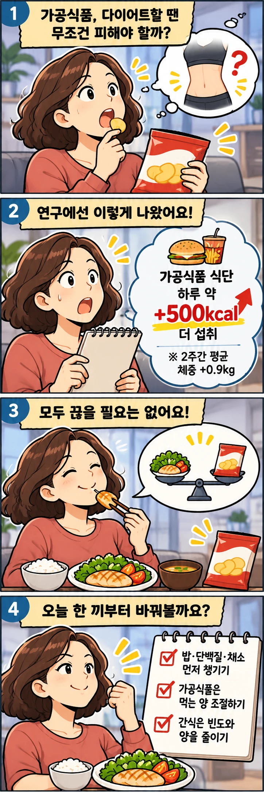

## 모두 끊는 것이 체중 관리의 필수 조건일까요?

초가공식품을 하나도 먹지 않아야 체중을 관리할 수 있다고 단정할 근거는 없습니다. 다만 초가공식품 위주의 식단에서 사람들이 더 많은 열량을 먹게 된 무작위시험은 있습니다. 여기서 얻을 실용적인 질문은 “이것을 먹으면 실패인가요?”보다 **“내가 자주 먹는 식사가 계획보다 더 먹기 쉬운 구성인가요?”**입니다.

## 초가공식품은 포장된 음식과 같은 뜻이 아닙니다

이 글에서 다루는 연구는 식품의 가공 정도와 목적에 따라 나누는 NOVA 분류를 사용했습니다. 초가공식품은 향료·유화제처럼 산업적 식품 제조에 주로 쓰이는 성분 등을 포함하는 식품군을 가리킵니다. 단순히 봉지나 용기에 담겨 있다는 뜻은 아닙니다. [NIH의 연구 소개](https://irp.nih.gov/news-and-events/in-the-news/irp-study-finds-heavily-processed-foods-cause-overeating-and-weight-gain)에서 분류의 취지를 확인할 수 있습니다.

따라서 포장을 봤다는 이유만으로 식품을 버리거나, 성분 하나를 발견하고 그 음식이 체중 증가의 원인이라고 판단하지는 마세요. **가공 분류를 아는 일과 실제 한 끼의 양·구성을 평가하는 일은 함께 필요합니다.**

## 같은 열량을 내놓았는데, 먹은 열량은 달랐습니다

2019년 Hall 연구진은 성인 20명이 연구시설에 한 달간 머물며 두 식단을 각각 2주씩 먹게 했습니다. 식단을 제공하는 순서는 무작위로 정했고, 각자 원하는 만큼 먹을 수 있었습니다. 제공 식단의 열량과 주요 영양소 등을 맞추려 설계했지만, 사람들이 실제로 먹은 양까지 같게 제한하지는 않았습니다.

초가공식품 식단에서 하루 섭취 열량은 다른 식단보다 평균 약 500kcal 많았습니다. 그 기간 평균 체중은 약 0.9kg 늘었고, 반대 식단에서는 비슷한 양이 줄었습니다. 이는 개인에게 예정된 변화량이나 체지방만의 변화량이 아니라, 해당 조건에서 측정한 평균 체중 변화입니다. [NIH 임상센터의 연구 설명](https://clinical.nih.gov/news/2019/summer/story-01)과 [논문 초록](https://pubmed.ncbi.nlm.nih.gov/31105044/)에 설계와 결과가 정리돼 있습니다.

핵심은 “같은 양을 먹어도 가공식품이라 더 살찐다”가 아닙니다. **먹을 수 있게 제공한 열량은 비슷해도, 자유롭게 먹었을 때 섭취량이 달라질 수 있었다**는 결과입니다. 음식 선택을 의지 문제로만 돌리기보다 식사 환경까지 살펴볼 이유가 됩니다.

## 왜 더 먹었는지까지 모두 밝혀진 것은 아닙니다

이 연구에서는 초가공식품 식단을 먹는 속도도 더 빨랐습니다. 그렇다고 빠르게 먹은 것만이 섭취량 차이의 원인이라고 확정할 수는 없습니다. 식단 전체를 바꾼 실험이므로 특정 첨가물 하나의 효과를 분리한 결과도 아닙니다. NIH도 어떤 특성이 섭취 행동과 체중 변화를 이끌었는지는 더 연구해야 한다고 설명합니다.

또한 성인 20명을 대상으로 각 식단을 2주씩 제공한 입원 시험입니다. 모든 제품이 같은 영향을 준다거나, 집에서 일부 식품만 바꿔도 같은 크기의 변화가 난다거나, 장기 유지까지 보장된다고 넓혀 읽을 수 없습니다. [NIH의 결과·한계 설명](https://www.nih.gov/news-events/nih-research-matters/eating-highly-processed-foods-linked-weight-gain)을 참고하시면 좋습니다.

## 전면 금지 대신 자주 먹는 한 끼를 점검해 보세요

다음은 연구 결과를 일상에서 살펴보기 위한 제안입니다. 시험에서 검증한 감량 처방이나 정해진 성공 공식은 아닙니다.

먼저 식사가 자꾸 간식으로 끝나는 때를 하나 골라 보세요. 늦은 퇴근 뒤 과자만 먹고 또 다른 것을 찾는 경우라면, 과자를 참는 목표에 더해 **바로 먹을 수 있는 식사 대안이 있는지** 확인합니다. 예를 들어 미리 준비한 밥·달걀·채소로 한 끼를 구성하는 방안을 생각할 수 있습니다. 이 예시는 특정 메뉴의 감량 효과를 보장하는 뜻은 아닙니다.

바꾸기 전에는 그때 먹은 음식과 추가로 꺼내 먹은 것을 짧게 적어 보세요. 바꾼 뒤에는 다음 항목을 함께 비교해 보시면 됩니다.

- 식사 뒤에도 계속 음식을 찾게 되는지 살펴보세요.
- 준비 시간과 비용이 생활에 맞는지 확인하세요.
- 원래 먹던 것에 새 음식을 계속 더하기만 한 것은 아닌지 돌아보세요.

직접 준비하기 어렵다면 완제품을 쓰면서 곁들일 음식을 정하는 방식도 선택할 수 있습니다. 완제품이라는 이유만으로 포기하지 말고, 실제로 어떤 식사가 완성되는지 보세요. 바꾸는 데 드는 시간·비용 때문에 계속 이어가기 어렵다면 더 간단한 조합을 찾는 편이 낫습니다.

초가공식품에 관한 연구는 음식 선택이 섭취량에 영향을 줄 수 있음을 보여 줍니다. 그 결과를 모든 포장식품의 금지 목록으로 바꾸기보다, **자주 반복되는 식사 하나를 골라 양과 구성을 조정하고 생활에 맞는지 확인하는 기준**으로 사용해 보세요.

## 참고 자료

- [Hall 등, 2019년 무작위 교차시험 논문 초록](https://pubmed.ncbi.nlm.nih.gov/31105044/)
- [NIH 임상센터: 연구 설계와 식사·체중 변화](https://clinical.nih.gov/news/2019/summer/story-01)
- [NIH: 연구 결과와 남은 질문](https://www.nih.gov/news-events/nih-research-matters/eating-highly-processed-foods-linked-weight-gain)
