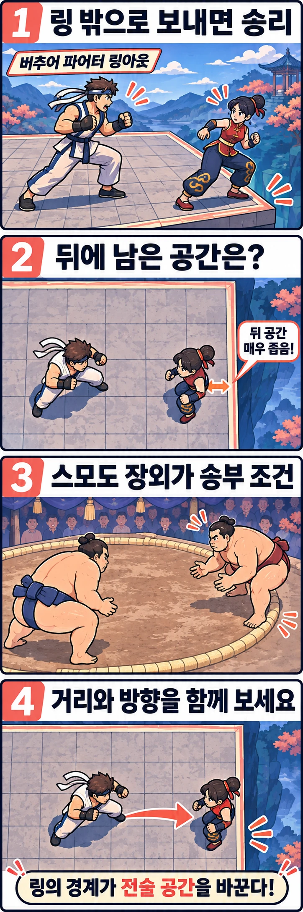

버추어 파이터에서 상대를 가장자리까지 몰았다면, 다음 공격은 무엇을 노려야 할까요? 강한 타격만 떠올리기 쉽지만, 이 게임에는 상대를 링 밖으로 보내 이기는 **링아웃**도 있습니다. 일부 스테이지에서는 경기장 끝이 단순한 배경을 넘어 직접적인 승리 목표가 됩니다.

이 설정을 실제 격투기와 연결해 보면 스모가 좋은 비교 대상입니다. 두 종목의 기술이 같다는 뜻은 아닙니다. **경계 밖으로 나가는 것이 패배로 이어질 때 공간의 의미가 달라진다**는 점을 함께 살펴보려 합니다.

## 링 끝에서는 무엇을 노리는지부터 달라집니다

[세가 공식 초보자 가이드](https://virtua-fighter.com/en/guide)는 상대를 구석으로 몰았을 때의 이점으로 일부 스테이지의 링아웃 승리와 벽 근처의 높은 피해량을 주는 연속 공격을 구분해 소개합니다. 상대의 이동과 공격이 제한된다는 설명도 덧붙입니다. 따라서 모든 경기장 끝을 같은 방식으로 이해하면 곤란합니다. 먼저 그곳이 벽인지, 밖으로 떨어질 수 있는 가장자리인지 살펴야 합니다.

여기서 읽어볼 전술적 의미는 공격의 성과가 여러 가지라는 점입니다. 같은 공격이라도 체력을 줄이는 것과 상대를 위험한 위치로 옮기는 것은 서로 다른 성과입니다. 링아웃이 가능한 가장자리에서는 두 번째 성과가 다음 공방의 목표를 바꿀 수 있습니다.

예를 들어 상대의 등 뒤에 경계가 가까운 상황을 가정해 보겠습니다. 중앙에서라면 공간을 내주며 거리를 다시 벌릴 선택을 생각할 수 있지만, 가장자리에서는 뒤로 물러날 공간부터 확인해야 합니다. 이는 특정 캐릭터의 확정 승리 공략이 아니라, 승리 조건에서 출발한 공간 해석입니다. 어떤 기술이 실제로 밖으로 보내는지는 기술과 위치에 따라 따로 확인해야 합니다.

## 스모에서는 밖으로 보내는 것 자체가 승리입니다

[미국 스모연맹의 규칙 안내](https://www.ussumo.org/rules)는 상대를 도효, 즉 스모 경기장 밖으로 내보내거나 상대의 발바닥 이외 부위가 바닥에 닿게 하는 것을 두 가지 기본 승리 방식으로 설명합니다. 이 글에서는 그중 장외로 내보내는 조건에 주목합니다.

이 규칙으로 경기를 보면, 뒤로 움직이는 동작도 남은 공간에 따라 다르게 읽힙니다. 중앙에서의 후퇴와 경계 바로 앞에서의 후퇴는 같은 여유를 주지 않습니다. 몸끼리 맞붙어 있을 때에도 상대와 나 사이의 간격만 볼 것이 아니라, 어느 쪽 뒤에 경계가 있는지 함께 볼 이유가 생깁니다.

다만 버추어 파이터를 스모의 재현으로 이해할 필요는 없습니다. 미국 스모연맹은 주먹으로 때리기와 발차기를 금지 행위에 포함합니다. 타격과 잡기를 함께 사용하는 게임의 기술 선택을 그대로 스모에 옮길 수는 없습니다. 비교할 수 있는 지점은 기술 목록이 아니라, 경계가 승리 조건에 들어가면서 생기는 공간의 압박입니다. 이 비교가 제작진의 공식 모티브 설명을 뜻하지도 않습니다.

## 경계까지의 거리만큼 방향도 보시면 좋습니다

가장자리에 가까운지만 세면 놓치는 것이 있습니다. 두 사람이 어느 방향으로 마주 보고 있는지도 중요합니다. 상대의 등 뒤가 바깥인 상황과, 바깥을 옆에 둔 상황은 같은 그림이 아닙니다. 공격 이후 상대가 어느 쪽으로 이동하는지까지 봐야 장외로 이어질 가능성을 생각할 수 있습니다.

게임에서 한 공방을 다시 본다면 다음 질문을 차례로 던져 보세요.

- 공격 전에는 누구의 뒤에 경계가 있었나요?
- 공격 뒤에는 두 사람의 위치와 마주 보는 방향이 어떻게 달라졌나요?
- 다음 선택은 체력 피해를 노렸나요, 바깥으로 보내는 것을 노렸나요?

이 질문은 “가장자리에서는 무조건 밀어붙이면 된다”는 공략과 다릅니다. 경계에 몰아넣었다는 사실과 실제로 링아웃을 만들었다는 결과 사이에는 상대의 대응과 다음 선택이 남아 있습니다. 특정 반격이나 탈출이 항상 가능하다고 단정하기보다, 위치가 바뀌는 순간을 찾아보는 관전 방법입니다.

## 멋진 한 방 옆에 남은 공간도 보세요

링아웃은 마지막에 밖으로 나가는 순간만 눈에 띄기 쉽습니다. 하지만 그 전에 중앙의 여유가 줄고, 마주 보는 방향이 바뀌며, 뒤로 이동할 선택이 부담스러워지는 과정도 함께 읽을 수 있습니다.

다음에 버추어 파이터를 플레이하거나 관전할 때는 기술 이름을 외우기 전에 경기장 모양과 두 사람의 위치를 잠깐 살펴보세요. 스모를 볼 때도 누가 앞으로 움직이는지만큼 누가 경계에 가까워지는지를 보시면 좋습니다. 강한 공격이 무엇인지에 더해, **그 공격이 상대를 어디에 남기는지** 묻는 순간 공방의 다른 재미가 드러납니다.

## 참고 자료

- [세가 버추어 파이터 공식 초보자 가이드](https://virtua-fighter.com/en/guide): 경기장 끝의 이점과 스테이지별 링아웃·벽 공방 설명을 참고했습니다.
- [미국 스모연맹 규칙 안내](https://www.ussumo.org/rules): 기본 승리 조건과 금지 행위를 참고했습니다.