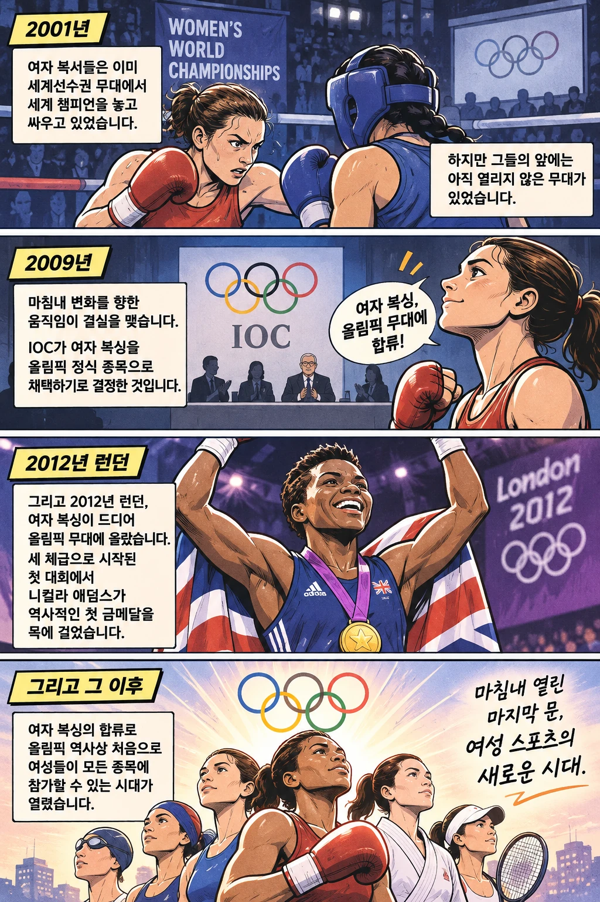

2012년 런던 올림픽에서 영국의 니컬라 애덤스가 여자 복싱 최초의 올림픽 금메달을 목에 걸었습니다. 그런데 여자 복서들이 세계 정상의 자리를 놓고 겨루기 시작한 것은 그보다 훨씬 전의 일이었습니다.

이미 세계선수권까지 열리고 있었는데, 왜 올림픽 금메달에 도전할 기회는 2012년에야 찾아왔을까요? 이 질문을 따라가다 보면 런던 대회의 의미가 복싱 한 종목을 넘어선다는 사실을 알 수 있습니다.

## 올림픽보다 먼저 시작된 세계 무대

당시 국제복싱연맹인 AIBA가 주관한 첫 여자 세계선수권은 **2001년 미국 스크랜턴**에서 열렸습니다. 여자 선수들은 이미 국제대회에서 타이틀을 놓고 경쟁하고 있었습니다. [국제복싱협회가 보존한 대회 소개](https://www.iba.sport/event/aiba-womens-world-boxing-championships-qinhuangdao-2012/)

하지만 올림픽에는 여자 복싱 경기가 없었습니다. 세계선수권에서 아무리 좋은 성적을 거두더라도 올림픽 챔피언이 될 수는 없었던 겁니다. 실력이 부족해서가 아니라, 도전할 무대 자체가 마련되지 않았기 때문입니다.

따라서 2012년은 여자 복싱이 처음 시작된 해가 아닙니다. **이미 링 위에서 싸우던 선수들에게 올림픽이라는 새로운 목표가 생긴 해**입니다.

## 2009년, 올림픽으로 향하는 길이 열리다

변화의 출발점은 2009년 8월 13일이었습니다. 국제올림픽위원회(IOC)가 2012년 런던 올림픽에 여자 복싱을 포함하기로 결정한 날입니다. 당시 AIBA는 오랫동안 추진해 온 목표가 실현됐다며 이 결정을 환영했습니다. IOC 위원장 자크 로게도 여자 복싱의 발전을 도입 이유로 설명했습니다. [당시 발표문](https://boxingontario.com/womens-boxing-included-in-2012-olympics/)

결정은 단순히 여자 선수도 출전할 수 있다는 선언에 그치지 않았습니다. 여자부에 세 체급을 신설하고, 체급마다 12명씩 출전하도록 정했습니다. 전체 복싱 선수 정원 286명을 유지하기 위해 남자부는 기존보다 한 체급 줄인 열 체급으로 편성했습니다.

이제 여자 복서들도 올림픽 메달을 향해 도전할 수 있게 됐습니다. 다만 처음부터 모든 체급에 그 기회가 주어진 것은 아니었습니다.

## 처음 열린 문은 세 체급뿐이었습니다

2012년 런던 올림픽 여자 복싱에는 세 체급이 마련됐습니다. 체급은 선수들을 몸무게에 따라 나눈 경기 구분이며, 아래 숫자는 당시 각 체급의 상한 체중입니다. [호주 올림픽위원회 복싱 역사](https://www.olympics.com.au/sports/boxing/)

| 당시 여자 체급 | 상한 체중 |
| --- | --- |
| 플라이급 | 51킬로그램 |
| 라이트급 | 60킬로그램 |
| 미들급 | 75킬로그램 |

당시 남자부가 열 체급이었던 것과 비교하면 차이가 컸습니다. 같은 해 중국 친황다오에서 열린 여자 세계선수권 역시 열 체급으로 치러졌지만, 올림픽 출전권을 놓고 경쟁할 수 있었던 체급은 그중 세 개뿐이었습니다. [당시 세계선수권 안내](https://www.iba.sport/event/aiba-womens-world-boxing-championships-qinhuangdao-2012/)

**문은 열렸지만, 아직 좁았습니다.** 세계 무대에서 경쟁하던 모든 체급의 선수들이 올림픽에 설 수 있었던 것은 아닙니다. 그럼에도 여자 복싱이 올림픽에 정식으로 포함됐다는 사실은 분명한 전환점이었습니다.

## 첫 금메달 이후에도 넓어진 기회

2012년 런던에서는 마침내 여자 복싱의 첫 올림픽 챔피언이 탄생했습니다. 영국의 니컬라 애덤스였습니다. 그녀의 우승은 여자 복싱이 올림픽 정식 종목으로 자리 잡았음을 보여주는 역사적인 기록이 됐습니다. [IOC의 여성 스포츠 역사 설명](https://www.olympics.com/ioc/news/women-and-sport-leaping-forward)

첫 대회의 세 체급이 끝은 아니었습니다. 이후 올림픽 복싱의 체급 편성은 조금씩 달라졌습니다. 도쿄 2020 대회에서는 여자부가 다섯 체급으로 늘었고, 남자부는 여덟 체급으로 조정됐습니다. [잉글랜드 복싱협회 올림픽 역사](https://www.englandboxing.org/team-england/boxing-at-the-olympics/)

런던에서 시작된 변화가 모든 격차를 한 번에 없애지는 못했습니다. 하지만 첫 출전 기회가 생긴 뒤, 그 기회를 넓혀 가는 변화도 이어졌습니다.

## 마지막 문이 열리던 날

2001년 첫 여자 세계선수권이 열렸을 때도, 선수들은 세계 정상의 자리를 놓고 치열하게 경쟁하고 있었습니다. 그러나 그들에게는 아무리 뛰어난 실력을 갖춰도 도전할 수 없는 타이틀이 있었습니다.

바로 **올림픽 챔피언**이었습니다.

2009년 올림픽 정식 종목 채택이 결정되고, 2012년 런던에서 니컬라 애덤스가 첫 금메달을 차지하기까지. 여자 복싱은 마침내 올림픽의 문턱을 넘었습니다.

그리고 그 순간의 의미는 한 선수의 우승이나 복싱 한 종목의 변화에만 머물지 않았습니다. 여자 복싱은 그때까지 여성 선수들이 참가할 수 없었던 마지막 올림픽 종목이었습니다. 여자 복싱이 합류하면서 **올림픽 역사상 처음으로 여성들이 모든 종목에 참가할 수 있는 시대가 열린 것**입니다. [IOC의 여성 스포츠 역사 설명](https://www.olympics.com/ioc/news/women-and-sport-leaping-forward)

물론 모든 세부 경기와 체급에서 남녀에게 같은 수의 출전 기회가 주어진 것은 아니었습니다. 하지만 여성 선수들에게 닫혀 있던 마지막 종목의 문이 열렸다는 사실만큼은 분명했습니다.

**2012년 런던에서 열린 것은 단지 여자 복싱의 올림픽 무대가 아니었습니다. 여성 스포츠의 역사에 새로운 시대가 열린 순간이었습니다.**

## 참고 자료

- [온타리오 복싱협회의 2009년 도입 발표](https://boxingontario.com/womens-boxing-included-in-2012-olympics/): 발표 날짜, 여자 세 체급과 출전 정원, 남자 체급 조정 및 당시 단체의 설명입니다.
- [국제복싱협회의 2012년 여자 세계선수권 소개](https://www.iba.sport/event/aiba-womens-world-boxing-championships-qinhuangdao-2012/): 2001년 첫 대회, 세계선수권 열 체급과 올림픽 예선 세 체급을 설명합니다.
- [호주 올림픽위원회 복싱 안내](https://www.olympics.com.au/sports/boxing/): 런던 여자부 도입과 세 체급의 상한 체중을 설명합니다.
- [IOC의 여성 스포츠 역사](https://www.olympics.com/ioc/news/women-and-sport-leaping-forward): 애덤스의 첫 우승과 모든 올림픽 종목으로 넓어진 여성의 참가 기회를 설명합니다.
- [잉글랜드 복싱협회 올림픽 역사](https://www.englandboxing.org/team-england/boxing-at-the-olympics/): 도쿄 2020의 여자 다섯 체급·남자 여덟 체급을 설명합니다.
